# AgentOS

A self-hosted home for your AI coding agents. Run Claude Code, Codex,
OpenCode and others side by side, in a chat or their own terminal. Hand off
tasks that end in a pull request, let an orchestrator review and merge them,
and check on all of it from your phone.

<picture>
  <source media="(prefers-color-scheme: light)" srcset="screenshots/hero-light.png">
  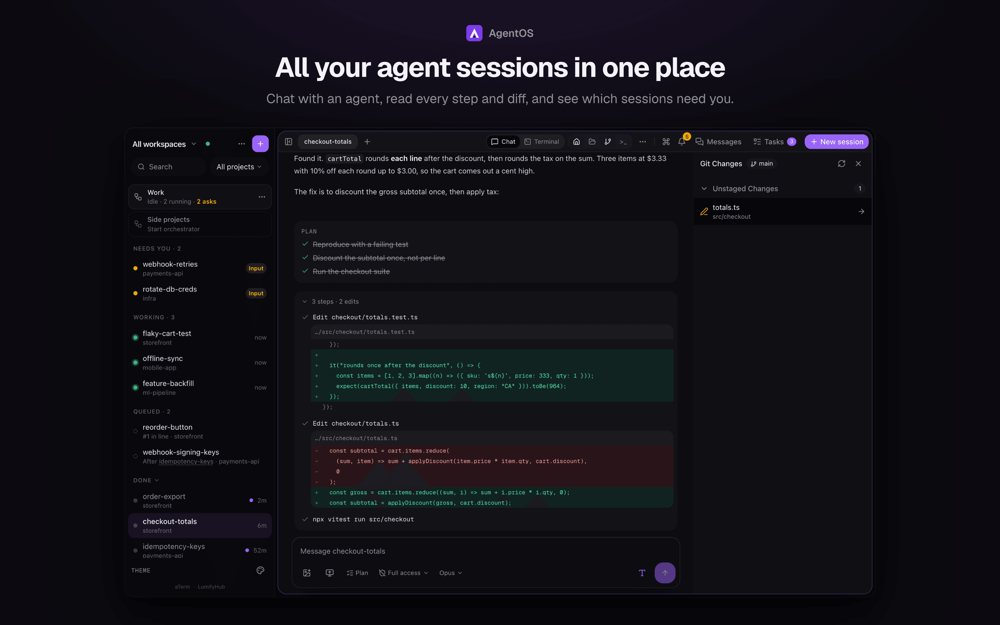
</picture>

## What it does

### An orchestrator for each workspace

Every workspace has one orchestrator, a chat pinned at the top of its list.
It starts tasks, answers agents that are blocked, and reviews and merges
pull requests through gates: CI green and settled, an independent review of
the exact commit (big diffs are reviewed in parts), nothing blocked, and the
diff in scope. Anything that is yours to
decide (publishing, money, something irreversible, credentials) waits as an
ask with Approve, Decline and Reply. Turn on **Require my approval** and
sensitive or large PRs wait for you too. [More](#orchestrator)

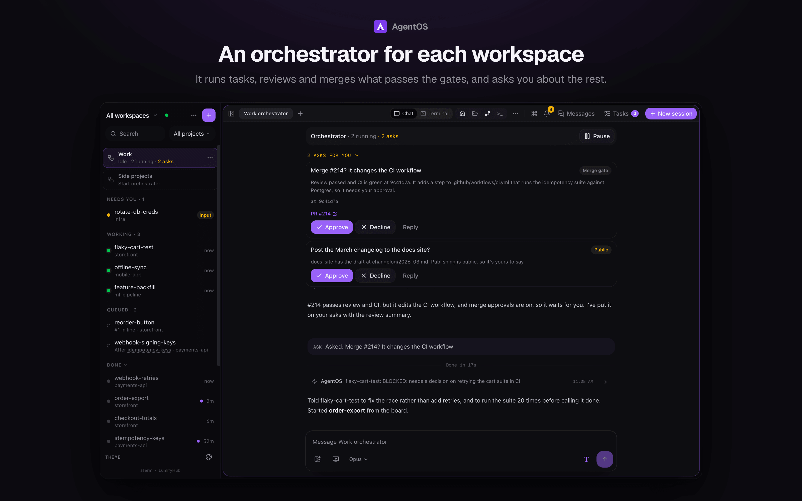

### Tasks that end in a pull request

A task gets its own git worktree, branch and ports, opens as a chat, runs
the project's code review before it opens its PR, and waits for your
sign-off. A workspace's running task limit (Settings → Workspaces) caps how many run at once; the rest
wait under **Queued** with their place in line and start on their own, and
`aos task --after` holds one until another finishes. [More](#tasks)

### Each kind of work on the right model

Planning, gate reviews and the orchestrator run on Opus, implementation and
scope checks on Sonnet, titles and summaries on Haiku, each editable in
Settings → Models and per workspace. A task plans on one model and
implements on another in the same conversation, can be resumed on any
model, and can run on another provider (DeepSeek, GLM, any
Anthropic-compatible endpoint) whose key stays a reference.
**Usage → Compare** shows Claude-only and routed tasks side by side.
[More](#model-routing)

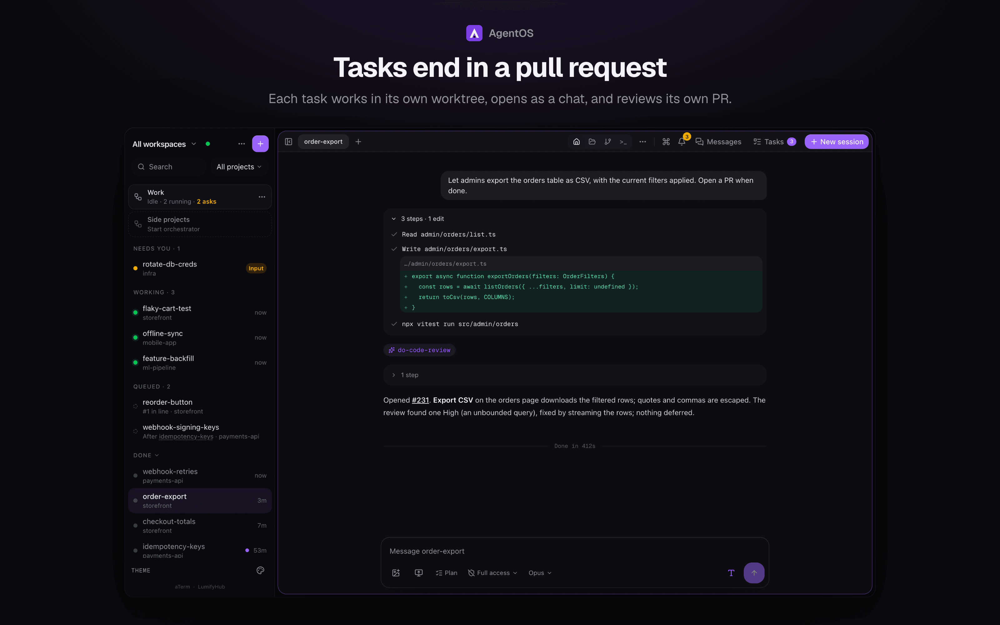

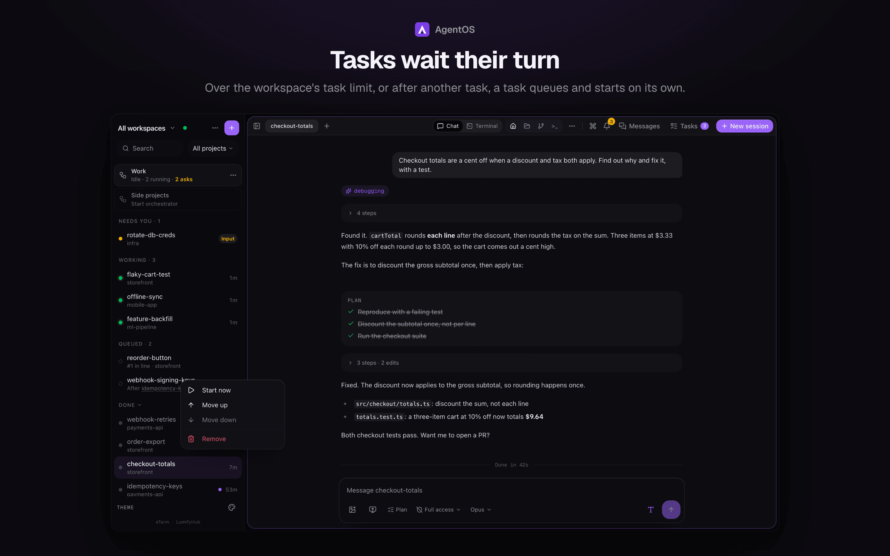

### Nothing starts until you send

⌥N opens a draft in the project you're in. Project, machine, agent, worktree
and base branch are chips on it, model and access sit under the composer, and
**Open a PR when done** makes it a task. Unsent drafts wait in the sidebar.
[More](#new-sessions)

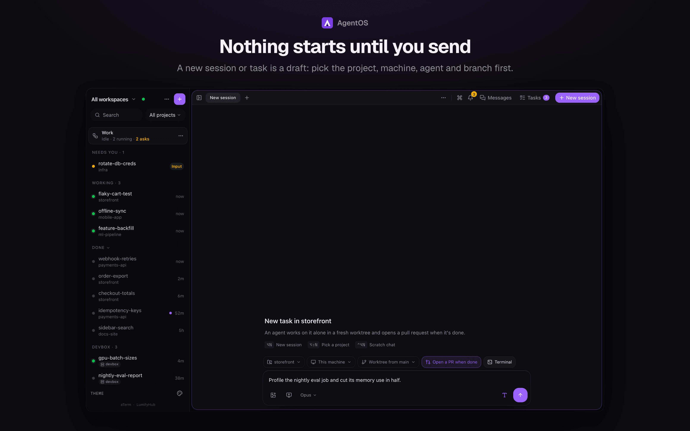

### Other machines in the same list

Link another machine that runs AgentOS and its sessions show up next to
yours, with the same rows, menu and address. Their chats and terminals are
relayed through this server. Pick the machine on a draft to start a session
or task there, even for a project that only lives here (it finds or clones
the repository), and move a running terminal task between machines.
[More](#machines)

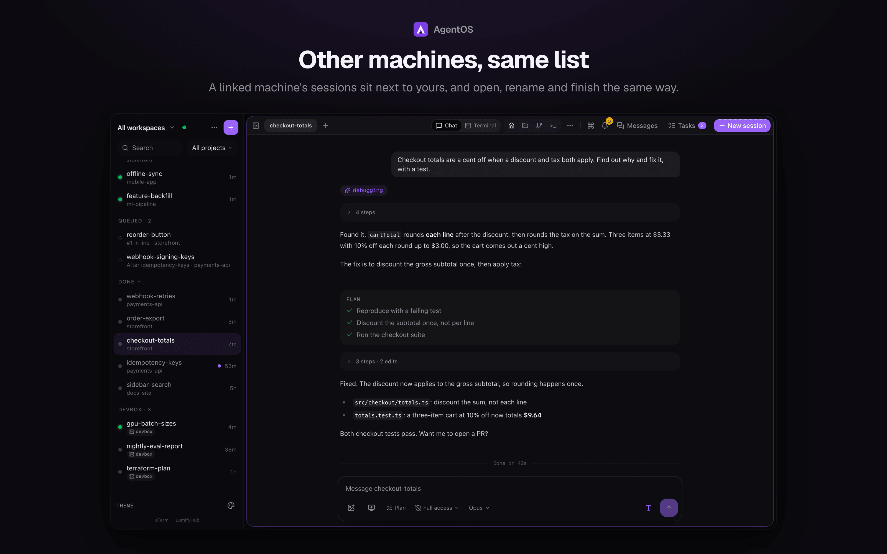

### Built for your phone

The whole app works on a phone, not a cut-down view. Every session has its
own link (`/?session=<id>`) you can bookmark or share between devices, and
pairing a new device is a QR code. Tailscale gives you an encrypted address
that works from anywhere. [More](#mobile-access)

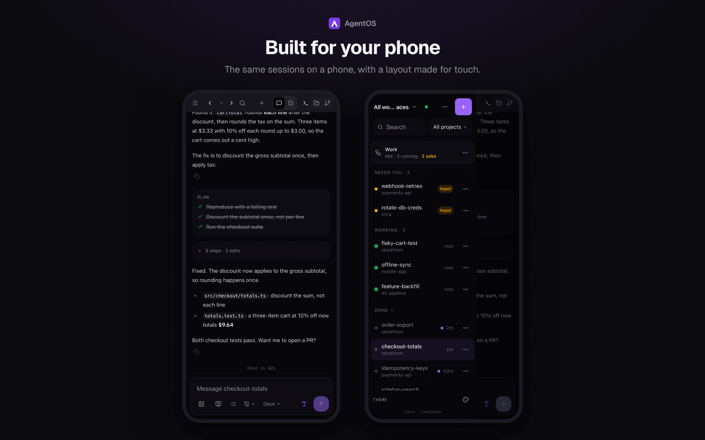

### Agents that talk to each other

Sessions find and message each other with `aos peers`, `aos send` and
`aos inbox`, start tasks and sessions, and schedule check-ins. You see every
conversation in **Messages** and can join in. [More](#agent-network)

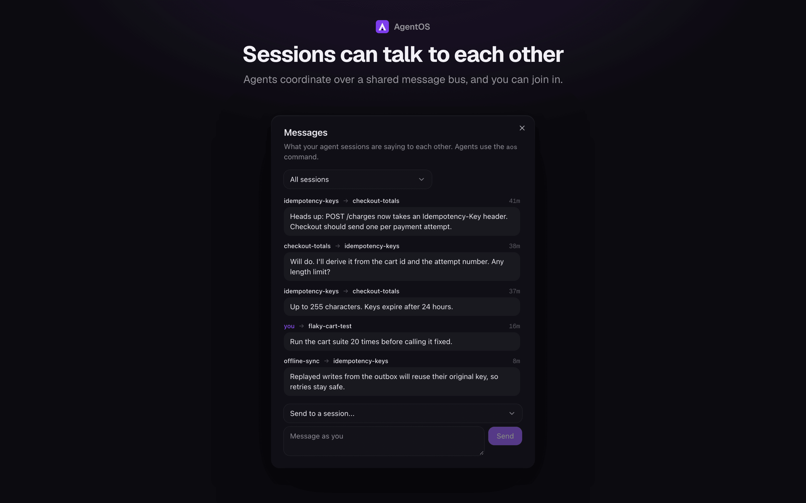

### And the rest

- **Chat or terminal, same conversation.** Streaming replies, steps and
  diffs, plan mode, a queue you can steer, slash commands and skills,
  `@file`, undo, and inline charts and pages. ⌘F (Ctrl+F) finds text
  anywhere in the conversation, tool output and older pages included, and
  opens the step it's in. One click hands the conversation to the agent's
  own terminal. [More](#chat)
- **Project config.** `agentos.json` (or an existing `.dispatch.json`) gives
  each session its own ports, environment, copied files, cloned
  dependencies, a private Postgres copy, and a "Running this project"
  section in the agent's brief. [More](#project-config-agentosjson)
- **Schedules.** Start tasks, chats or orchestrator prompts on a timer, or
  check in on a session, with run history. [More](#schedules)
- **Stacks.** Run a board's cards as stacked PRs that merge bottom-up.
  [More](#stacks)
- **Machine load.** A gauge in the sidebar, each session's share of CPU and
  memory, and a note to agents before they start a full test suite or build
  on a busy machine. [More](#machine-load)
- **Status from the screen and the agent.** Every session moves between
  Needs you, Working and Done as it changes, including programs that report
  their own state (OSC 7501). [More](#the-sidebar)
- **Also:** a ⌘K palette for every session and action, code search, a file
  picker with uploads from a phone, a git panel (diffs, commits, PRs), dev
  servers (Node and Docker), up to four panes side by side, dictation in the
  terminal toolbar, and tmux sessions you started yourself listed under their
  project.

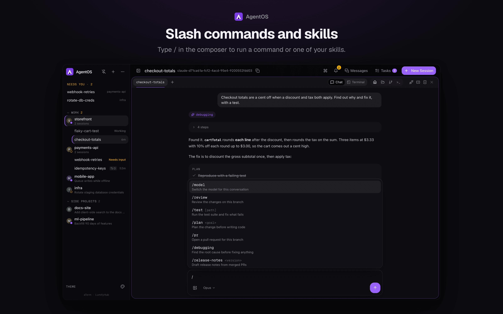

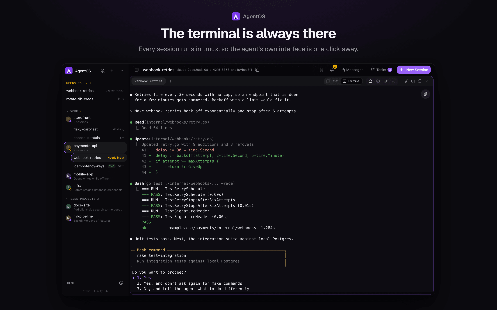

## Install

You need Node.js 20+, tmux, and at least one agent CLI:
[Claude Code](https://github.com/anthropics/claude-code),
[Codex](https://github.com/openai/codex),
[OpenCode](https://github.com/anomalyco/opencode),
Pi,
[Kilo Code CLI](https://kilo.ai/docs/cli),
[Gemini CLI](https://github.com/google-gemini/gemini-cli),
[Aider](https://aider.chat/), [Cursor CLI](https://cursor.com/cli) or Amp.

```bash
npm install -g @saadnvd1/agent-os
agent-os install   # checks for tmux and ripgrep, installs what's missing, builds the app
agent-os start     # runs in the background on http://localhost:3011
```

Without Node.js, the install script sets up everything:

```bash
curl -fsSL https://raw.githubusercontent.com/saadnvd1/agent-os/main/scripts/install.sh | bash
agent-os start
```

From source:

```bash
git clone https://github.com/saadnvd1/agent-os
cd agent-os
npm install
npm run dev  # http://localhost:3011
```

Then open AgentOS, add a project from ⌘K, and press ⌥N. To use it from your
phone, see [Mobile access](#mobile-access).

### Windows (WSL2)

AgentOS runs on Windows inside WSL 2, as a Linux install. WSL 1 isn't
supported (`wsl --set-version <distro> 2`). In an Ubuntu or Debian distro,
run the install script above: it installs Node.js, tmux, ripgrep, lsof, a
compiler for the native modules, and `wslu`, then prints the WSL next steps.
The installer and the server both detect WSL the same way (the kernel
release names Microsoft, or `WSL_DISTRO_NAME` is set).

- **Open it from Windows** at `http://localhost:3011`. WSL 2 forwards
  localhost to the distro by default, and the server's loopback address is
  what's forwarded. Use `localhost`, not `127.0.0.1`: passkeys only work on
  localhost or https. With `networkingMode=mirrored` in `.wslconfig`
  (Windows 11), Windows and the distro share localhost directly. From a
  phone or another machine, install Tailscale inside the distro and use
  [Mobile access](#mobile-access) as on Linux.
- **Keep projects in the Linux filesystem** (`~/code/...`), not on the
  Windows drive (`/mnt/c/...`). Git, npm and file watching are many times
  slower there, and changes made from Windows aren't seen by file watchers
  (inotify doesn't cross the boundary), so the "/" menu only picks up new
  skills after its cache expires. The folder picker warns on `/mnt/<drive>`,
  and the server log lists projects that live there.
- **Links** open in the Windows browser through `wslview` (from `wslu`), or
  `explorer.exe` when it isn't installed. The server never touches the
  clipboard; copy buttons use the browser's.
- **Approvals with a passkey** use Windows Hello in the Windows browser,
  registered for `localhost` (a passkey made on the tailnet https address is
  a separate one).
- **Start at login**: `agent-os enable` writes a systemd user service, which
  needs systemd in the distro. Add this to `/etc/wsl.conf`, then run
  `wsl --shutdown` from Windows and reopen the terminal:

  ```ini
  [boot]
  systemd=true
  ```

  WSL still stops an idle distro, service and all, a few seconds after its
  last terminal closes. To keep AgentOS up without a terminal open, add this
  to `%UserProfile%\.wslconfig` (Windows 11) and start the distro at Windows
  login, for example with a Task Scheduler task running
  `wsl.exe -d <distro> -- sleep infinity`:

  ```ini
  [general]
  instanceIdleTimeout=-1
  [wsl2]
  vmIdleTimeout=-1
  ```

What's been verified: the WSL detection and the installer's WSL paths have
unit tests that run on any OS, and the manual [WSL workflow](.github/workflows/wsl.yml)
ran on a GitHub-hosted Windows runner (Windows Server 2025, Ubuntu 24.04
under WSL 2): the installer detected WSL 2 and installed what was missing
through apt, tmux, lsof and node-pty worked, the server started and logged
its WSL note, and Windows reached it at both `localhost:3011` and
`127.0.0.1:3011`. Untested: Windows Hello approvals, links opening through
`wslview`/`explorer.exe`, mirrored networking, `agent-os enable` under
systemd, the idle-timeout settings above, and Debian or other distros.

### First run

On a fresh install (no sessions, no projects of your own) the web app opens a
short setup at `/?welcome`: it shows each agent CLI as ready, needing a
sign-in, or missing, installs or signs one in from an embedded terminal, adds
a first project (a folder, a clone or an empty one), then opens a session in
it. Every step after the first can be skipped. It is remembered on the server,
so a phone you pair later doesn't see it, and an install that already has work
never does. Reopen it from Settings → Setup (**Run setup again**) or at
`/welcome`; `AGENTOS_SKIP_WELCOME=1` turns it off.

### Supported agents

| Agent       | Chat | Resume | Fork | Auto-approve                                 |
| ----------- | ---- | ------ | ---- | -------------------------------------------- |
| Claude Code | ✅   | ✅     | ✅   | `--dangerously-skip-permissions`             |
| Codex       | ✅   | ✅     | ✅   | `--dangerously-bypass-approvals-and-sandbox` |
| OpenCode    | ✅   | ✅     | ✅   | `--auto`                                     |
| Pi          | ✅   | ✅     | ✅   | Never asks                                   |
| Kilo Code   | ❌   | ✅     | ✅   | Config file                                  |
| Gemini CLI  | ❌   | ❌     | ❌   | `--yolo`                                     |
| Aider       | ❌   | ❌     | ❌   | `--yes`                                      |
| Cursor CLI  | ❌   | ✅     | ❌   | `--force`                                    |
| Amp         | ❌   | ✅     | ❌   | `--dangerously-allow-all`                    |
| Oh My Pi    | ❌   | ❌     | ❌   | N/A                                          |

Agents without chat run in the terminal. The new-session picker says when an
agent isn't installed or needs a sign-in first, and what to run.

### CLI

```bash
agent-os run              # start and open the browser
agent-os start            # start in the background
agent-os stop             # stop the server
agent-os restart          # stop, then start
agent-os status           # show its addresses
agent-os pair             # add a phone, tablet or laptop (prints a QR code)
agent-os logs             # tail the logs
agent-os update           # update to the latest version
agent-os enable           # start at login (disable turns it off)
agent-os passkeys reset   # when every passkey is lost (see Orchestrator)
agent-os uninstall
```

# Reference

Everything below is how each part works, in detail.

## Chat

Sessions open as a chat by default: streaming replies, tool calls folded into
expandable steps, inline diffs for edits, a plan checklist, highlighted code
and mermaid diagrams, subagent cards, image attachments (pick, paste or drag
them in) and a Stop button, all readable on a phone. Chat drives the same
agent as the terminal, with your own logins: Claude Code through the Agent
SDK, Codex through `codex app-server`, OpenCode through its own `opencode
serve` (loopback only, behind a per-conversation password) and Pi through its
RPC mode. Pi never asks before a tool, so AgentOS loads a small Pi extension
that asks the chat as the access setting says. The **Chat /
Terminal** switch in the tab bar hands the same conversation between the two:
the terminal resumes it (`claude --resume`, `codex resume`, `opencode
--session`, `pi --session`), and switching back closes the
terminal so only one side drives it. Each chat conversation runs in its own
worker process (in tmux, like terminal sessions), so restarting or updating
AgentOS never cuts off a turn: the server reconnects to running workers when
it starts. A worker from an older build finishes its turn, and any
background work (subagents, shells), then hands over at the next turn
boundary: messages that arrive meanwhile wait in the queue, and a current
worker resumes the same conversation with this build's tools and sends them.
An orchestrator fed events mid-turn picks up new tools this way with nobody
restarting it. A turn whose worker did go away mid-step is resumed
once, with a note telling the agent to check what it was doing, and a task's
orchestrator hears about it. History is kept in AgentOS.

The composer formats markdown as you type: `code`, **bold**, _italic_, lists,
`- [ ]` task lists, and ` ```ts ` fenced blocks with syntax highlighting.
What it sends is the markdown you typed, character for character. Code pasted
from an editor (or anything multi-line that reads like code) lands in a code
block, prose stays prose, and a paste of 32 KB or more becomes an attachment
sent as a fenced block. Cmd/Ctrl+Shift+V pastes as plain text, and the **T**
button (Cmd/Ctrl+/) turns live formatting off for this browser. Enter sends on
a keyboard and is a newline on a phone; Cmd/Ctrl+Enter always sends.
Shift+Enter is always a newline, and three of them at the end of a code block
leave it.

Type `/` in the composer for every slash command and skill the agent knows,
yours included, filtered as you type. A skill or command you add or edit
(in `~/.claude/skills`, `~/.claude/commands` or the project's own) shows up
on its own; the menu's refresh button reloads the list now. Commands such as `/compact`, `/usage`
and `/context` run in chat and show their output inline; skills the agent
invokes on its own appear as a chip. `/model` (or the picker under the
composer) switches the model mid-conversation. `/mcp` lists the session's MCP
servers with their status and tools, without spending a turn. Commands that
only make sense in a terminal, such as `/vim`, are left out, and say so if
typed anyway.

Type `@` for files and folders, matched the way Claude Code matches them
(ripgrep over the folder until the agent is running), and pick one to insert
`@path`. After each turn but the first, the agent's guess at your next message
shows in the empty composer: **Tab** or **→** takes it, typing or **Esc** sets
it aside; on a phone it's a chip to tap. **↑** and **↓** in an empty composer
walk back through what you've sent. Select text in a reply and **Quote** puts
it in the composer as a blockquote.

A message sent while the agent is working waits in a queue above the
composer, kept on the server so a reload doesn't lose it, and goes when the
turn ends. Queued messages can be edited, moved or removed, and **Send now**
stops the turn (as Esc does) and sends that one with the stop, so it's the
very next thing the agent reads, ahead of a background task's notice it had
waiting. A message typed right after Esc goes the same way.

**Plan mode** (the **Plan** toggle under the composer, or Shift+Tab) has the
agent read and plan without changing anything; it's remembered per session.
When the agent has a plan it shows up as a card: **Carry it out** leaves plan
mode and starts it, **Keep planning** goes back to the composer.

The ring in the tab bar (in the composer on a phone) is how full the
conversation's context is, measured against the room before auto-compact:
amber past 60%, red past 85%. Tap it for the breakdown and **Compact now**.

Two thresholds (Settings → Workspaces → Compact; 0 turns one off). Mid-turn,
the agent compacts itself at 300k by default: AgentOS launches Claude Code
with `CLAUDE_CODE_AUTO_COMPACT_WINDOW` set to that size (its floor is 100k),
high enough that a long job isn't cut in half. Between
turns AgentOS catches what it didn't: a chat over its 150k threshold is compacted
before the next message, and so is one idle past its prompt cache (5 minutes
or an hour, read from the agent's own usage), whose next message would
re-read the whole conversation at the cache-write price. A chip above the
composer says "Idle 47m · 412k context · Compact first?": Send compacts and
then sends, **Send as-is** skips it for that one message. Messages nobody is
typing (the orchestrator's `send`, AgentOS events and wakes, `aos send`,
schedules) compact first on their own, only between turns, and the chat
shows one quiet line with the context before and after. An orchestrator
isn't compacted (a summary would lose the fence around what it read from
tasks and CI): it starts a fresh conversation from its brief and the current
state at its fresh-start threshold, or earlier once idle past its cache.
While a chat compacts (any trigger, Claude, Pi or Codex) it is shown as
compacting, not just working: a pulsing blue dot and a "Compacting" chip in
the sidebar, and "Compacting context… 182k tokens" above the composer. The
status API (`/api/sessions/status`) keeps `status: "running"` and adds
`compacting: { since, before? }`; the orchestrator's `sessions` tool says
"compacting context". It clears when the compaction ends, errors, is
stopped, or the worker goes away.
What survives a compaction: the summary is asked to keep the task, scope
changes, every edited file by path, what's done, in progress and next, and
the decisions. Right after it, AgentOS hands back a note built from its own
records (a task's brief and scope changes, the files it edited, its todos,
the latest message and `git status`), which doesn't depend on what the
summary kept, and tells the agent not to re-read or rewrite whole files.
Terminal agents don't get the note yet.
On a desktop browser the screen button attaches a screenshot of a screen or
window you pick; on a phone, attach a screenshot as a photo.

**Usage** (the sidebar's ⋯ menu, or the palette) shows the account's 5-hour
and weekly windows, and what chats cost today, over 7 or 30 days, by day,
workspace and session. Costs are the agent's own estimates, recorded as each
turn ends. **Gate reviews** below it shows what the orchestrator's
independent reviewer and scope check cost, by PR: they run as `claude -p`
and leave no transcript, so each run's tokens, model and duration are read
from its JSON result into `check_runs`, and the review's verdict says them
too. Every compaction is kept in `chat_compactions` (who ran it, whether it
fired `mid_turn` or `between_turns`, and the context before and after), so cost per task can be compared by date.
Rows from before the column existed, and any written by a chat worker still
running older code, have a NULL `phase`: read those as unknown
(`COALESCE(phase, 'unknown')`), not as either kind.

**Esc** stops a running turn, as it does in Claude Code's terminal, unless a
menu, dialog or the command list is open (those close first). On a phone the
Stop button does the same. A stopped turn keeps what it wrote.

Stop ends the turn even while the model is still thinking, before any tool
call: the turn is interrupted, and if it hasn't ended within a few seconds the
agent process is ended and restarted for the next message (not if the chat is
waiting on an approval or question, or if a new message has started a new
turn meanwhile). The conversation and
worktree are kept, and whatever is sent next (yours, another agent's, the
orchestrator's) runs as the next turn, never queued behind the stopped one.
The UI, the orchestrator's `stop` tool and `aos stop` all take this one path
and report "stopped" or a real error.

A turn that has produced nothing (no token, tool call or result) for 8 minutes
shows as **Stalled** in the session list, and its workspace's orchestrator gets
one event naming the session, how long it has been silent and its last action.
It fires once per stall and starts over when the session does something. A
foreground tool call gets four times as long, and a session waiting on a
background command it started isn't flagged. Set the time (2 to 120 minutes, 0 for off)
in Settings → Workspaces → Stall alerts.

The access picker under the composer sets what the agent may do on its own:
**Ask first** (an approval card in the chat for anything not already allowed),
**Accept edits** (edits files, asks before other commands) or **Full access**
(the default, like running with permissions skipped). Questions the agent asks
you come up as cards to answer. **Undo** on a message puts back the files the
agent edited since, rewinds the conversation to before it, and returns the
message to the composer to edit and resend. Changes made by shell commands
aren't tracked, so they stay.

While a turn runs, a line above the composer says what the agent is doing
and for how long (with Stop), and every step shows its time. Work the agent
starts in the background (shells, subagents, monitors) sits behind a
"running in background" chip: each task with its elapsed time, its live
output, and its own Stop. The session list says the same thing, so a long
wait never looks like nothing is happening.

**Visuals.** Every chat agent (not an orchestrator, which reads other
sessions' text and gets no browser) has two tools: `html_preview` renders a page in
headless Chrome and hands back a screenshot plus the console, so it can check
its own work, and `html_render` shows the finished page (a chart, a table, a
mockup) inline as its own card, with full screen and "open in new tab". Pages
are kept under `~/.agent-os/artifacts/<session>/` with a row in SQLite, so
they survive reloads and restarts (`GET /api/sessions/<id>/artifacts` lists
them). They're served behind the same device gate with a CSP sandbox and no
same-origin access, so a page can't read AgentOS cookies or call its API; the
preview browser gets an empty profile and a proxy that only reaches public
addresses. An image or SVG file the agent writes shows inline when its reply
links to it by absolute path. The tools read files and reach the web, so
under **Ask first** they ask like any other tool. Previews need Chrome, Chromium, Brave or Edge
installed (or `AGENTOS_CHROME` pointing at one).

Chat runs on this machine, and on linked machines through their own AgentOS
(see [Machines](#machines)); sessions on machines reached over ssh only use
the terminal.
Drivers for other agent CLIs plug into `lib/chat/drivers`; undo, `@file`
suggestions and visuals are Claude-only for now, and plan mode is Claude and
OpenCode.

## Tasks

Hand off work and keep going. A task is a draft with **Open a PR when
done** turned on (**New task** in ⌘K, the sidebar's New menu or the Tasks
panel opens one). AgentOS creates a git worktree and branch, starts Claude there in tmux
with a brief to finish by pushing and opening a pull request, and tracks it:
Working, Needs input, Blocked, Ready for review, Checks failing or Agent
exited. **Sign off & merge** merges the PR (refused while CI is failing
or pending), then removes the session, worktree and branches. **Drop** closes
the PR and removes everything. Agents never merge their own work.

**Merging settings.** How a PR merges (sign-off, Done, Land and the
orchestrator's external PRs alike) and what's cleaned up after it are set in
**Settings → Merging** (or ⌘K → Merge settings) for every project,
and overridden per project in its **Project Settings → Merging** or in its
`agentos.json`:

```json
{
  "merge": {
    "method": "rebase",
    "delete_remote_branch": true,
    "delete_worktree": false
  }
}
```

`method` is `squash` (the default), `merge` (a merge commit) or `rebase`.
GitHub enforces the repository's allowed methods: if it refuses the one set,
the merge fails with a message naming the method and the repository setting
to turn on (Settings → General → Pull Requests), and AgentOS never falls back
to another method. The project's settings show a method its repository has
turned off. `delete_remote_branch` and `delete_worktree` (both on by default)
delete the branch on origin and the local worktree with its branch after a
merge. With either on, `main`, `master` and `HEAD` are never deleted, nor a
branch a stacked task still targets, nor a worktree holding uncommitted work
or commits the merge didn't include. The most specific setting wins: the
project's, then `agentos.json`, then the global one.

**Queued tasks.** A workspace can limit how many tasks run at once (none by
default; set it in **Settings → Workspaces**, or `PATCH /api/workspaces/<id>` with `{"maxRunningTasks": 3}`, or
`null` for no limit). A task started over the limit is queued, with no
worktree or agent yet, and starts by itself in line order when one finishes
(merged, dropped or done). `aos task --after <task|any>` (and the
orchestrator's `start_task` with `after`) holds a task until a named task
finishes, or until any task still working now does (a running task whose PR
was closed or merged doesn't count; with none, it starts at once). The
orchestrator's `drop` removes a queued task by its id. Pause stops automatic starts,
and the orchestrator's brakes still apply when its queued tasks start. The
line is kept in the database across restarts (`GET /api/tasks/queue`; start
now, move up or down, or remove with `/api/tasks/queue/<id>`). The sidebar
shows them under **Queued** with their place in line or what they wait on,
and the same actions in each row's menu; a row becomes the task's own row
when it starts. Why it works
this way: [docs/decisions/2026-10-10-queued-tasks.md](docs/decisions/2026-10-10-queued-tasks.md).

A paired device's token can run the building loop through read-only routes:
`GET /api/start-options?projectId=` (agents and models, the models a task can
run on, machines, branches, whether a task plans first, in one request),
`GET /api/tasks/<id>/diff` (the task's whole change, base to head: a file list,
then `?file=<path>` for one file's patch; capped, with `truncated` when a cap
is hit; read from the worktree, else the PR), and `GET /api/tasks/<id>/checks`
(the PR head's checks, the tail of a failing job's log, and the review gate's
verdict). A task's `plan` in `GET /api/tasks` carries `status` (`writing`,
`ready` or `approved`), a title and capped text. Their shapes are in
`lib/tasks/loop-types.ts`, which has no server imports so a client can share it.

## Model routing

Each kind of work AgentOS launches an agent for runs on its own model, set in
**Settings → Models** (⌘K → Model settings). A model is named
`provider/model`:

| Role                                                | Default                               |
| --------------------------------------------------- | ------------------------------------- |
| Task planning (a task's plan step)                  | `anthropic/claude-opus-5-5`           |
| Gate review                                         | `anthropic/claude-opus-5-5`           |
| Task implementation                                 | `anthropic/claude-sonnet-5-5`         |
| Orchestrator                                        | `anthropic/claude-opus-5-5`           |
| Scope check                                         | `anthropic/claude-sonnet-5-5`         |
| Interactive sessions                                | `anthropic/claude-opus-5-5`           |
| Chat & summary helpers (titles, summaries, PR text) | `anthropic/claude-haiku-4-5-20251001` |

The most specific setting wins: a task's own model, then its workspace's
(**Settings → Workspaces → Models**), then Settings, then the default.
`AGENTOS_REVIEW_MODEL` (gate review and scope check) and
`AGENTOS_TITLE_MODEL` (helpers) in the server's environment still replace a
role's default where Settings names none. A
Claude session you start without a model runs on the interactive role's. One
an orchestrator starts (its `start_session`, or `aos spawn` run from an
orchestrator) is recorded as started by it (`started_by`) and runs on the
implementation role instead, so delegated work doesn't use Opus by default;
`start_session` takes a `model` (`"provider/model"`, checked like a task's:
gate roles can't be set, other providers must be enabled). One you pick a
model for keeps it.

**Plan, then implement.** A chat task whose planning and implementation
models differ starts with a plan step: its first turn runs on the planning
model and writes the plan to `.agentos/plan.md` in its worktree (ignored by
git), changing nothing else. When that turn ends, the same conversation
switches to the implementation model (a live model switch, or a resume with
`--model` when the provider changes) and is told to follow the plan. Turn it
off in Settings, or per task with `plan: false`. Terminal tasks skip it. An
orchestrator decides it for every task: `start_task` requires `plan` and a
short `plan_reason`, stored on the task and shown on its card ("Planned:
touches 6 files across gates and UI" / "No plan: one-line default change"),
and **Usage → Compare** splits cost into planned and not. When the plan step
finishes, the orchestrator gets one event with the plan file's path and a
3-5 line summary; the handoff to implementation stays automatic.

**Plan only.** A task started with `plan_only` (`start_task`'s `plan_only`,
`aos task --plan-only`, or `plan_only: true` on `POST /api/tasks`) writes its
plan on the planning model and then stops: no model switch, no implement
prompt, even when one model does every role. It sits in a **Plan ready**
state (`plan_phase` `awaiting`, stored on the task, so it survives a restart)
that isn't blocked, doesn't count as needing you, and holds no agent process
(its worker is released; the conversation resumes on approval). The
orchestrator gets one event with the plan's path, a summary and that the task
is waiting. **Approve** on the task row (plan viewable there), `POST
/api/tasks/<id>/approve-plan`, or the orchestrator's `approve_plan(task,
message?)` continues it on the implementation model, once; a message amends
the plan and is recorded on the task's brief as a scope change, so the review
judges against it. Reject with **Drop**. A chat task on this machine only; it
can't move until approved.

**Per task.** The task draft has a **Model** chip ("Routed by role", or one
model); `POST /api/tasks` and the orchestrator's `start_task` take `model`, as
`"provider/model"` for the task's own roles or a map such as
`{"implement": "zai/glm-5.3"}`, and `plan`. Its gate review and scope check
never follow a task's model, only Settings and its workspace, so work can't
pick its own reviewer. **Resume on model…** on a task's row
(or `POST /api/tasks/<id>/model`, or the orchestrator's `set_task_model`)
moves a paused task to another model: same conversation, same worktree, and
it keeps that model from then on. Each turn records the model, provider and
role it ran as.

**Providers.** `anthropic` is your Claude login and needs no key. Others are
Anthropic-compatible endpoints (OpenAI-compatible ones can be defined and
tested, but Claude Code can't run on them): a base URL, where the key lives,
the models, and Claude Code's opus/sonnet/haiku tiers mapped to them so
subagents and background calls stay on that provider. DeepSeek
(`https://api.deepseek.com/anthropic`) and Z.ai GLM
(`https://api.z.ai/api/anthropic`) ship as presets, off until given a key.
Claude stays the default: another provider runs only where a role or a task
picks it. If a role's provider is turned off or its key can't be read,
helper runs, reviews and the orchestrator fall back to the role's default
rather than fail. **Test provider** sends one tiny request and says whether it
answered. Changing models, providers or the test runs only from this machine
or over Tailscale, never from a paired device: a provider's URL and key
reference decide where a key is sent.

The key is never stored by AgentOS. A provider names where to read it: a
tokenvault entry (`tv get <project> <desc>`), a macOS Keychain item
(`security find-generic-password -s <service> -w`) or an environment
variable named `*_API_KEY` (not `ANTHROPIC_`, `CLAUDE_` or `AGENTOS_`). It's read when an agent launches and goes only into that agent's
environment (`ANTHROPIC_BASE_URL` with `ANTHROPIC_AUTH_TOKEN` or
`ANTHROPIC_API_KEY`), never its command line, the database, a prompt or a
log; a terminal task's shell reads it from the reference itself. Errors that
might echo a key are scrubbed of it.

**Usage → Daily: the usage ledger and the ratchet.** Every Claude response
an AgentOS chat makes (subagents and the orchestrator included) is written to
`usage_calls` as it arrives, with its input, cache read, 5-minute and 1-hour
cache write and output tokens, its model, its context size and the
session, task, workspace and role it belongs to. Terminal sessions, which no
worker watches, are read from Claude's transcripts, and gate reviews come
from `check_runs`; the same message id is never counted twice. Tokens are
_weighted_ by the API's price ratios (Opus input 1, 5-minute write 1.25,
1-hour write 2, cache read 0.1, output 5; Sonnet half, Haiku a quarter), an
estimate of how much of the plan's limits a call uses.

The 5-hour and weekly windows come from the `rate_limit_event`s Claude Code
sends on each response (the `anthropic-ratelimit-unified-*` headers), stored
with their time in `rate_limit_readings` with no extra calls. An event
carries one window, so the weekly figure can go stale: when it is over 6
hours old it is estimated from recorded usage and marked `~`.

A rollup job inside the server (no model) writes one `usage_rollups` row per
day: weighted total, cost per merged PR, cost per _clean_-merged PR (the
headline: cost against quality), review cost per PR, the share of calls above
200k context, model mix, orchestrator share, the weekly %, and the quality
readings from existing data: first-try clean-merge rate (the first reviewed
head passed review and CI, no gate failures, no later head), fix rounds per
PR, gate escalations, scope changes, and escapes (a revert or fix PR touching
the same files within 3 days, from `gh`; unknown rather than zero if `gh`
fails). Spans of days are ratios of sums. The baseline is the first week of
rollups and only ever moves to a better value. One phone alert fires (and
stays quiet until it clears) when the 3-day cost per merged PR is over
baseline by 15%, or the clean-merge rate is under it by 10 points, naming the
supporting metric that moved most. The margins, the days averaged and the
minimum merges to judge are settings (`usage.alert_cost_pct`,
`usage.alert_clean_points`, `usage.avg_days`, `usage.alert_min_merges`,
`usage.baseline_days`, `usage.weekly_stale_hours`). A dev server doesn't run
it unless `AGENTOS_USAGE_ROLLUP=on`; `AGENTOS_USAGE_ROLLUP=off` turns it off
in production. `POST /api/usage/rollups` runs the nightly pass now. Task
cards show each task's weighted cost so far.

**Usage by model.** **Usage → By model** shows tokens and estimated cost per
role and per model in the plan's 5-hour window and the last 24 hours, from
the price table in Settings → Models (dollars per million input, cache
write, cache read and output tokens, editable).

**How to read the comparison.** **Usage → Compare** (or ⌘K → Model
comparison, or the sidebar menu) puts Claude-only tasks (the baseline,
including everything from before routing) beside routed ones, per provider,
over 7, 30 or 90 days, with a total column. A task counts under the provider
its own planning and implementation turns ran on; its reviews and checks add
to its cost wherever they ran. For each column: tasks, turns, tokens,
estimated dollars (list prices; for Claude, what the API would charge),
Claude window points per task (how far each turn moved the plan's 5-hour
window, an estimate), agent time, CI green on the first push, review passed
on the first try, gate failures and rework commits per task (heads checked
after the first review), and merged or dropped. Outcomes come from the
orchestrator's checks, so tasks it didn't run have cost but no outcome. A
column with fewer than 10 tasks is marked a small sample: a hint, not a
result. Parity means the routed column's outcome rows match the baseline's
while its window points per task drop. Why it works this way:
[docs/decisions/2026-10-11-model-routing.md](docs/decisions/2026-10-11-model-routing.md).

## New sessions

⌥N (the **+** on a phone) opens a draft: a composer in the current project, or
the one you used last. Nothing exists until you send. Then the session is
made, and with a worktree its setup runs in the chat, stage by stage: fetch,
worktree, env files, dependencies, the project's setup script, with a log
tail. The first message waits in the queue until setup is done, so the agent
never starts on half-installed dependencies, and a restart can't lose it. The
worktree starts on a temporary branch, renamed from the first message once
it has a title (it keeps the temporary name if there's nothing to name it
from).

⌥N reuses the project's empty draft; a draft you've typed in stays in the
sidebar's **Drafts** until you send or discard it. A new draft takes the
agent, model and access you were using; a project's own agent and model win.
Chats with no project run in `~/.agent-os/scratch`.

A task or session started from a prompt gets a short name: the brief's first
heading at once (when the prompt points at a readable `.md` brief), then a
2-6 word title from a quick Haiku call a few seconds later. A chat opened as
"Session 4" is named after its first message. Anything named by hand, a card's
title, a schedule's name or `--name` is kept as given.

The agent starts once its worktree has its dependencies. On macOS the main
checkout's `node_modules` (and workspace ones like `apps/web/node_modules`)
are cloned with `cp -Rc` when the lockfile matches, and a spare clone waits in
`~/.agent-os/spare` so the next task takes it by rename, in milliseconds.
Otherwise, and on Linux, the lockfile's frozen install runs (`npm ci`,
`pnpm/yarn/bun --frozen-lockfile`), then a plain install, always with
devDependencies even though the server runs with `NODE_ENV=production`. A
project's `agentos.json` can name exactly what to copy and clone, and its
`setup` commands (without a `clone`) replace the install; see
[Project config](#project-config-agentosjson).
Starting a task returns at once and shows **Setting up** until the agent
launches; a restart in the middle resumes it. A failed setup shows on the task
and is in the agent's first prompt (redacted, as data).

Tasks don't review their own PRs. The orchestrator's independent review of
the PR's exact head commit is the one review: `sign_off` and a stack's
**Land** refuse a PR without a passing one, and a PR body with AI
attribution. A head AgentOS rebased itself is covered by the review of the
head it rebased while the PR's own patch is unchanged. A task may still run
`/do-code-review` (the project's `.claude/skills/do-code-review`, or Claude
Code's `/code-review`) on a risky change before its PR; it's no longer
required. The review agents are in [.claude/agents](.claude/agents) and the
skill in [.claude/skills](.claude/skills/README.md).

Requires the GitHub CLI (`gh`) signed in, and a project with a GitHub remote.

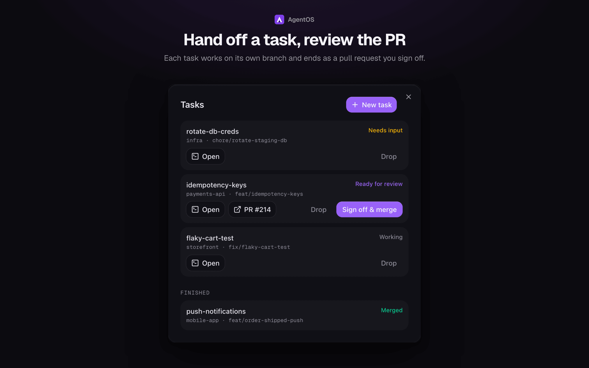

Tracking PRs stays inside GitHub's GraphQL quota (5,000 points an hour).
Only running tasks are asked about: a finished task's PR comes from the
database. One `gh pr list --state open` per repository a minute covers every
running task with an open PR, and a branch without one is asked about on its
own at most every 5 minutes. A merge or sign-off always asks fresh. When gh
reports a rate limit, every gh call backs off until the limit resets, and gh
failures are logged as `[gh] ...`, at most once a minute for each kind.

### Project config (`agentos.json`)

A project describes how its sessions run in `agentos.json` at the repository
root. Every field is optional:

```json
{
  "ports": { "RAILS_PORT": 3000, "VITE_PORT": 3100 },
  "env": { "STORAGE_PROVIDER": "disk" },
  "copy": [".env", "config/master.key"],
  "clone": ["node_modules"],
  "setup": ["bin/setup"],
  "dev": "bin/dev",
  "ready": { "url": "/up", "port": "RAILS_PORT" },
  "test": "bundle exec rspec",
  "browse": { "login": "/dev/login", "map": "docs/browsing.md" },
  "database": { "from": "app_development", "env": "DATABASE_NAME" },
  "notes": ["Kill your own server by port: lsof -ti tcp:$RAILS_PORT"],
  "merge": { "method": "squash" },
  "deploy": {
    "deployed": "~/.deploy/deployed",
    "health": "https://app.example.com/up"
  }
}
```

`merge` sets the project's merge method and branch clean-up (see
[Merging settings](#tasks)).

`deploy` is how [Away mode](#orchestrator) checks a merge went live: `deployed`
is a file your deploy writes the deployed commit to, `failed` (optional) one it
writes a commit whose deploy failed to, and `health` (optional) a URL that
answers 2xx once the server is back (a path alone is this AgentOS server's own,
as this repository's `agentos.json` uses with `scripts/autodeploy`'s state
files). A merge counts as deployed once the `deployed` commit contains it and
`health` answers; as failed when the `failed` commit contains it, the server
doesn't come back within 3 minutes (or, when its health answer has a
`startedAt`, hasn't restarted since the merge), or it isn't deployed `within_minutes`
(30) after the merge. No `deployed` file on the machine means nothing deploys
there, and nothing is checked.

Every task and worktree session takes a **port slot**, and each named port is
`base + slot` (a project with no `ports` still gets a `PORT` from 3100), so
parallel sessions never share a dev server port. The slot is kept on the
session and freed when it's done or deleted (an archived or merged one's once
its agent has stopped). The ports and
`env` are exported to the setup commands, the agent and its terminals; a port
always wins over an `env` entry of the same name, and `env` can't set names a
shell, runtime, git or the agent reads (`PATH`, `NODE_OPTIONS`, `TERM`,
`GIT_*`, `ANTHROPIC_*`, `AGENTOS_*`…): a config that sets one, such as
`NODE_OPTIONS` or `TERM`, is refused, and the error names the variable and why. The agent's brief gets a
short **Running this project** section: its ports, the dev command, how to
wait for `ready` in one backgrounded call, the test command, the login URL on
its own port, the browsing map and the notes. Only declared fields are
mentioned, and `env` values never are. Keep secrets out of the file: it is
committed.

With `database`, every task and worktree session gets its **own Postgres
database**, a copy of `from` named `<from>_aos_<hash of the session>`, made
before setup runs and exported as `env` (default `DATABASE_NAME`, plus
`PGPORT`/`DATABASE_PORT` and `PGHOST`/`DATABASE_HOST` when `port`/`host` are
set), so one session's migrations never reach another's. It's copied with
`pg_dump` into a database created from `template0`, not `createdb -T <from>`,
which refuses while the dev server is connected to `from`. Only a local server
is used (`host` may be `localhost`, `127.0.0.1`, `::1` or one socket folder), and
`from` must be a plain database name. A copy left by an earlier start of the
same session is reused. When Postgres isn't answering or the copy fails, the
session still starts, without one, and its brief says so. The copy is dropped
when the session is done, merged, dropped, moved away or deleted, and only one AgentOS made
for that session (its comment names the session): `from` and any other
database are never touched.

The file is validated against
[agentos.schema.json](lib/project-config/agentos.schema.json); a broken one
fails the setup with every bad field named, rather than being ignored. Without
an `agentos.json`, a `.dispatch.json` is read with the same meanings, then the
legacy `.agent-os/worktrees.json` and `.agent-os.json`. The config is always
read from the main checkout, so an agent can't change its own environment by
editing it, and the merge gates flag an edit to it as agent config. The full
schema, including the fields later releases implement (MCP servers, apps,
recipes), is in
[docs/decisions/2026-10-10-agentos-json.md](docs/decisions/2026-10-10-agentos-json.md).

### Stacks

A project whose board is linked to LumifyHub can run the whole board as
**stacked** tasks: **Tasks → From the board → Run as stack** shows the plan
first, then starts it. A card starts as soon as every card it's blocked by has
a PR open (not merged), on top of the card it depends on most: its branch is
cut from that card's pushed branch, and its PR targets it, so each PR shows
only its own commits. At most three run at once without a PR (adjustable).

Merging goes bottom-up. Signing off a card whose parent hasn't merged is
refused; after a parent merges, every card stacked on it (grandchildren
included) is rebased and its PR retargeted, and its agent is told. This works
with every merge method: only the child's own commits are replayed onto the
default branch, whether the parent was squashed, rebased or merged with a
merge commit. **Land**
merges every PR in order after checking all of them are open and green, and
waits for each restacked PR's checks before merging it. A chat card's agent
is stopped between turns before anything merges (Land waits up to 5 minutes
for a running turn, and refuses, naming the card, if it doesn't end), and
what it's sent during the land waits in its queue. A conflict stops on
that card with the exact command to fix it.

### Schedules

A schedule starts agent work at set times without you opening AgentOS:
**Schedules** in the workspace menu, the sidebar's **⋯** menu, or ⌘K. Each has a
name, a time (presets for hourly, daily, weekdays and weekly, or any
five-field cron expression, in America/Chicago unless you pick another zone),
a project and a prompt, and starts one of:

- **Task**: a background task that ends in a pull request, as above.
- **Session**: a chat session in the project that runs the prompt and stays.
- **Orchestrator**: the prompt, posted to the workspace's orchestrator as a
  message from "Schedule <name>", marked as a scheduled prompt so it never
  counts as an approval.
- **Message**: the prompt, sent to a session you pick the way `aos send`
  does, marked the same way. A chat whose agent has exited (idle chats stop
  after 30 minutes) is started again to take it. The run records `delivered`,
  `queued` or why it failed. **Schedule check-ins** in a session's **⋯** menu
  fills one in. The session is stored by id, so renaming it changes nothing.
  An archived session fails the run until it's back. When the session is
  deleted or a finished task, the schedule
  turns itself off on the first run that finds it gone and says so once, in
  the orchestrator's chat and on your phone; point it at another session or
  delete it. The orchestrator isn't a target (it has its own kind):
  `aos schedule add --session <the orchestrator>` makes an orchestrator
  schedule, so it follows whichever session is the workspace's orchestrator.
  A schedule an agent made with `aos schedule add` stays in that agent's
  workspace and reaches its target labelled as that agent's request, not
  yours.

The server checks once a minute and claims each run in SQLite before starting
it, so a time never runs twice. If AgentOS was off when runs were due, it
runs only the most recent one when it comes back, marked **caught up**. A run
is **skipped** while the schedule's previous task or session is still working,
and while the workspace's orchestrator is paused. A run that fails to start is
recorded with why, noted in the orchestrator's chat and sent to your phone
(see below), once per failing streak: not again until a run starts. Every run stays in the
schedule's history with a link to what it started. **Run now** runs one
immediately, even while the last run is still working (Pause still holds it).
Task and session runs go through the orchestrator's brakes, like its own
starts: a braked run is skipped with the brake's reason and tried again on the
next minute until the brake lifts or a newer run is due (Run now obeys them
too, once). A schedule whose project has moved to another workspace fails
until it's edited. Removing a schedule keeps its history.

**One-off schedules.** Pick **Once** in the form (a date and time in the
schedule's zone), or `aos schedule add --at "tomorrow 10am" ...` (an ISO time,
`in 2h`, a weekday; America/Chicago unless `--tz`). It works with every kind,
runs once and then turns itself off; the run stays in its history, marked
done, and the schedule moves to the **Done** group. Upcoming one-offs are
listed first with their run time, how far off it is and who made it (you or an
orchestrator), each with Run now, Edit and Cancel; the count shows in the
sidebar menu and the orchestrator's header. The same claim-in-SQLite rule
applies, so it never runs twice, and one AgentOS missed while off runs when it
returns, marked **caught up**. Pause holds a one-off until you resume rather
than skipping it, and the brakes apply as for any run. A past time is refused.
Run now uses up its only run; edit it to a new time to run it again. An
orchestrator makes its own with `remind_me`: at least ten minutes ahead, 20
pending at most, in its own workspace, and it arrives as a scheduled prompt,
never an approval.

Task and session schedules run at most hourly, message schedules at most
every 10 minutes and skip a run (`still working`) while their session is
still busy, mid-turn or holding a queued message. A task schedule waits
while any task it started is unfinished (working, waiting on you, in review
or failing checks), so it can't stack up pull requests. Only one server
process runs schedules (it holds a lease in the database); a dev server runs
none unless `AGENTOS_SCHEDULES=on`, and `AGENTOS_SCHEDULES=off` stops them in
production.

### Machine load

The dot in the sidebar header is the machine's load: green, amber (load
over 1.5 per core, or memory pressure warning) or red (over 3 per core, or
critical pressure), with some slack before it drops back. Tap it for the
numbers and the sessions using the most CPU; a busy session's row shows its
own share ("3.1 cores · 4.2 GB"), summed over its terminal's process tree
from one `ps` every 30 seconds.

Nothing is ever stopped, paused or queued. Instead, before an agent starts a
whole test suite, type check, build, repo-wide lint, `xcodebuild` or
`pytest`, the Claude hook AgentOS installs tells it what heavy commands are
already running and how loaded the machine is, so it can narrow the run or
wait. Targeted runs (`vitest run lib/x.test.ts`) are left alone. `aos heavy
-- <cmd>` does the same for anything else. When the load stays red for two
minutes, one message goes to your phone and to each workspace orchestrator,
naming the top sessions and their heavy commands; the next one waits until
it has been green for ten minutes. `AGENTOS_LOAD=off` turns it all off.

### Tmux cleanup

Deleting, finishing, dropping or marking a session done ends its tmux session
and every process its panes started, on the machine it runs on. At start,
AgentOS also ends tmux sessions it created (its `<agent>-<uuid>` and
`aos-chat-<uuid>` names, or the `AGENTOS_SESSION_ID` it sets at launch) whose
session no longer exists, and logs each as `[tmux-sweep]`. Sessions it didn't
create are never touched. The sweep runs only in production mode (a dev or test instance shares the tmux server but not the database); `AGENTOS_TMUX_SWEEP=off` skips it.

### Phone notifications

Two things reach your phone: a schedule run that failed, and whatever an
agent sends on purpose with `aos notify "<text>"` (the orchestrator's morning
report, a real milestone). Status changes don't; that's the in-app Needs-you
list. Each source sends at most one a minute: anything more inside the minute
waits and goes out as one message (kept in the database, so a restart
doesn't lose it; past 20 waiting, more are dropped), and the same text twice
goes once.

Set it up in **Settings → Notifications** (⌘K → Phone notifications, or the
line at the bottom of Schedules), one of:

- **Command**: `AGENTOS_NOTIFY_CMD` in the server's environment, a shell
  command that gets the message on stdin. It wins when set. For example, a
  Telegram sender on another machine:
  `AGENTOS_NOTIFY_CMD='ssh -o BatchMode=yes me@box "NOTIFY_SOURCE=agentos ~/bin/notify"'`.
- **Telegram**: a bot token and your chat id. The token is kept in the
  database and never shown again, returned by the API or logged.

#### Push to the phone app

A machine linked to Connect sends to the paired phones that have registered
for push, instead of Telegram. A push is generic: the title "AgentOS", a
category word and a link to open, no session or task text (the payload is a
versioned envelope, so an encrypted body can replace it later). It goes
through the Connect relay, signed with the machine key; AgentOS keeps a
`push_outbox` that retries with backoff, forgets tokens the relay reports as
dead, and caps alerting pushes at 10 an hour per device (one summary after).

- **What pushes**: an ask raised, a session waiting on you for a minute,
  a task ready for review, CI or a review failing, a plan ready to approve,
  and the Away digest. Merged is off by default. Each device picks its
  categories (`PATCH /api/devices/me/push`). A task mirrored from another
  machine never pushes from here.
- **Quiet rules**: waiting, review, CI and merged don't push while you're at
  this Mac (keyboard or mouse used in the last 3 minutes). While Away is on,
  everything except asks folds into the 10-minute digest.
- **Fallback**: agent messages, the Away digest and machine alerts (load,
  schedules) go to Telegram when push isn't configured or fails. The newer
  events are push-only. If Connect says push isn't set up yet, AgentOS
  stops asking for 10 minutes and uses Telegram meanwhile.
- **Check it**: `aos push test` sends a real push to each registered phone
  and prints what came back; Settings → Devices shows each device's push
  state, categories, last error and a Send test button.

## Agent network

Sessions started by AgentOS can find and talk to each other without you,
through the `aos` command on their PATH (any agent CLI can use it; Claude is
also briefed on it):

In a chat, a message from another session shows as theirs, with the
sender's name, rather than as one you typed.

```bash
aos peers                         # sessions, their project, what each is doing
aos send <session> "message"      # wakes the other session with the message
aos inbox                         # read messages sent to you
aos history <session>             # your conversation with a session
aos spawn <project> "prompt"      # start a new agent session in a project
aos task <project> "prompt"       # start a background task that ends in a PR
                                  # (both take --name "..." before the prompt;
                                  # task takes --after <task|any> to queue it;
                                  # a task opens as a chat, --terminal for tmux)
aos move <session> <machine>      # carry a task on there ("here" brings it back)
aos stack <project> [--plan]      # run the project's board as stacked tasks
aos stacks                        # every stack and where each card is
aos schedules                     # every schedule, its next run and last outcome
aos schedule run <name>           # run a schedule now
aos schedule add --session <s> --every 30m "prompt"  # check in on a session
aos notify "text"                 # push a message to your phone
aos push test                     # a real test push to the paired phones, and the result
aos heavy -- npm test             # run it now; says first what else heavy is running
aos stop <session>                # stop its turn now; the next message runs as a new turn
aos done <session>                # finished: merge through the gates, archive
aos done --all-idle               # the same for every idle session around you
aos docs [query]                  # LumifyHub pages, when the workspace is linked
```

Messages are delivered by typing them into the recipient's terminal, labelled
as coming from another agent, and a rate limit stops two agents looping.
Delivery is checked against the pane: the text has to reach the input and
leave it on Enter (retried once as a bracketed paste), and a menu on screen is
never typed into. `aos send` says `delivered`, `queued` (the agent was busy and
will see it after its turn) or `FAILED: <why>` with exit code 2; a chat session
counts as delivered once its worker records the message. Either way the
message waits in the recipient's `aos inbox`.

Sessions are addressed by name, `project/name`, id or a unique id prefix, and
renaming one keeps its old names: a message to "Session 3" still reaches the
session now called "orchestrator", and `aos peers` shows
`orchestrator (was Session 3)`. If another session has since taken the old
name, the current owner wins and `aos send` says so. A name that matches more
than one session is refused with the candidates listed. The
**Messages** panel shows every conversation and lets you message any session.
Sessions on other machines can receive messages but not yet send them.

## The sidebar

One flat list of every session in the current workspace, each row naming its
project underneath. The workspace's orchestrator comes first, as a compact row
with its state and how many of its asks wait on you; it starts pinned there,
and unpinning it from its ⋯ menu (remembered per workspace) drops it among the
other sessions. Sessions sit on shelves: **Pinned** (pin from a row's ⋯
menu), **Needs you** (an approval, a question, a terminal waiting for input, a
message typed and never sent, a failed task, or the orchestrator's open asks,
each with a badge), **Working**,
and **Done**. Done is folded to one row, "3 done today · 12 earlier", until you
tap it (open or folded is remembered per device); open, it lists newest first,
ten at a time. The orchestrator's row carries small chips for the work it
started: running, in review, blocked and queued, each left out at zero. Tap
them to show only that orchestrator's work on the same shelves; the "Showing
… work ×" chip at the top clears it (it resets on reload). A session an
orchestrator started has a small orchestrator icon on its row. A purple dot marks a session that
finished or changed since you last opened it. Search matches
titles and project names, and the project filter narrows the list to one
project and holds that project's own actions: new session, terminal, dev
server, settings, board, workspace.

Every session has its own address, `/?session=<id>`: open it in a new tab,
on a phone or from a bookmark and that session opens; **Copy link** in a row's
⋯ menu or the pane's menu copies it. The address bar follows the focused
pane's session, each switch is a history entry so back and forward move
between sessions, and an address for an archived or unknown session says so
and opens the usual home. A device that isn't paired is sent through pairing
and comes back to the same session; the address grants nothing by itself.

**Settings** (the sidebar's ⋯ menu, or ⌘K → Settings) holds every setting in
one place: **Merging** (the approval switch, merge method and branch
clean-up, with the projects that override them), **Workspaces** (each one's
running task limit), **Devices & access** (pairing, passkeys, network),
**Notifications** (this browser's sound and alerts, and your phone) and
**Schedules**. Each section has its own address, `/?settings=<section>`
(`merging`, `workspaces`, `devices`, `notifications`, `schedules`), beside
`?session=`; on a phone the sections are a list, then the one you open.

Rows move the moment a session changes state: the server pushes every change
over `/ws/status` (behind the same device gate as the terminal). The same
stream says when anything else on screen changed: database triggers mark the
tables written (sessions, stacks, schedules, asks, bus messages and more,
whoever wrote them), and the git panel's folders are polled once on the
server for every viewer. The browser refetches only what moved, so an idle tab
makes about one request a minute instead of forty. Messages are numbered: a
reconnecting phone picks up what it missed, or takes a fresh snapshot when
it's been away too long. While the socket is down, the old polling carries on.
API JSON is gzipped and the sockets use permessage-deflate.

**AgentOS reads OSC 7501**, the [Program Status
Protocol](https://www.superlogical.com/rex/docs/build/program-status): a
program in a terminal session can say it's `working`, `blocked` (on a
permission, a question or a sign-in), `done`, or failed, and that wins over
reading the screen. Blocked lands on Needs you with Approve, Answer or Sign in
and the program's message (plain text, capped); done gets the unread dot.

```sh
printf '\e]7501;state=blocked:kind=permission:app=me:msg=%s\e\\' "$(printf 'Apply 3 changes?' | base64)"
```

tmux drops sequences it doesn't know, so AgentOS watches each local terminal
session through tmux control mode: one long-lived, read-only `tmux -C`
client per session (tmux 3.2 or newer) pushes the pane's raw output, which
carries the reports, and keeps a copy of its screen for reading status, so
nothing polls `capture-pane` or taps panes with `pipe-pane`. A screen is kept
only while its pane prints, and it's checked against tmux again whenever
output settles. A session's terminal views share one `tmux attach` (it runs at
the smallest view's size), and a view that can't keep up is held back and sent
the current screen once it catches up. On older tmux, or with
`AGENTOS_TMUX_CONTROL=off`, AgentOS falls back to copying each session's
output to itself (`tmux pipe-pane`, through a unix socket only you can reach;
needs `nc`) and reading screens with `capture-pane`. Claude Code sessions AgentOS starts on this
machine report through hooks it installs (`~/.agent-os/claude-status-hooks.json`,
passed with `--settings`). Not covered yet: sessions on other machines (their
output never passes through this one), Codex and the other agents (Codex only
notifies when a turn ends, with nothing for "working" or "blocked"; they keep
reading the screen), and the terminfo
`Pst` capability (the pane's terminal is tmux's).

The screen covers what no report says. A selection menu at the bottom of a
terminal (Claude Code's "Enter to select · ↑/↓ to navigate", a Codex "› 1."
list) lands on Needs you with **Answer** and its question, for sessions
without the hooks. Text typed into a Claude Code or Codex input box and left
unchanged for a minute while the agent sits idle lands there with **Unsent**
and the text, so a message that never got sent doesn't wait for hours. The
dim suggested prompt in the same box doesn't count. Claude Code fires no hook
when a question is dismissed with Esc, so a question report clears once its
input box is back on screen.

## Workspaces

Group projects into workspaces (e.g. Work, Personal) from the workspace
switcher at the top of the sidebar, which also picks the workspace the list
shows and holds the current one's orchestrator, clean-up, Archived and
LumifyHub link. Move a project in from the project filter's menu. Deleting a
workspace keeps its projects.

### Done

**Done** (a session's ⋯ menu; `aos
done`; or the orchestrator's `done` tool) is for finished work, where
**Stop** keeps everything and **Drop** rejects it. A task with an open PR
merges first, only through the orchestrator's gates at the judged commit; a
failing gate refuses with its name and nothing merges. A task already
merged, or a session with no PR, just cleans up. If GitHub can't be read, or
a task that had a PR has none now, done refuses rather than guess.

Cleanup stops the agent and archives the session. The worktree goes only if
nothing in it would be lost: never with uncommitted changes; after a merge,
only when every commit on it is in the merged PR or on a remote; otherwise
only when its branch has no commits of its own. Anything else is kept and the
reply says why, naming the uncommitted files. Files setup copied in (env
files, agentos.json's `copy`) don't count while they still hold exactly what
was copied; setup records them, hashed from the main checkout, in the
worktree's git directory. Cloned dependencies are gitignored, so never count. A sign-off from Tasks or the orchestrator follows the same
rule. A branch merged on GitHub is deleted on origin when origin's tip is the
commit that merged.

Archived sessions leave the sidebar, the needs-you count, session statuses
and the orchestrator's view, but are never deleted; the **Archived** view
(the workspace switcher for one workspace, or ⋯ in the sidebar header for
all of them) lists
them with Unarchive, which only puts the entry back.

**Clean up idle sessions** (the workspace switcher) first shows what will happen
to each idle or stopped session, and `aos done --all-idle` does the same
sweep. A clean-up never merges: open PRs are listed for their own done.
`aos done` reaches only sessions in the caller's workspace (or project).

### Session logs

When a task merges, AgentOS writes a log of it. It costs no model tokens: the
log is a fixed template filled from records AgentOS already holds, and nothing
that makes it can call a model (a test holds it to that). Dropped tasks get
none.

A log holds:

- **Header:** task name and id, workspace, project, branch, PR number and
  link, merge commit, start, merge time and duration.
- **Brief:** the task's prompt and every scope change recorded on it, in
  order.
- **Plan:** `.agentos/plan.md`, read at the merge before cleanup removes the
  worktree. A task with no plan says so.
- **Timeline:** PR opened, gate failures per commit (CI with the failing
  check's name, review, scope), each review and scope verdict per commit with
  its text trimmed, escalations to you and your answers, and the merge.
- **Usage:** tokens, estimated cost and model per role, from the usage ledger.
- **Outcome:** the task agent's last message, verbatim.
- **Links:** the PR and the session.

Text from tasks, CI and reviewers is untrusted. It is written inside fences
or code spans, so it can't add headings or links to the document, and
credential-shaped strings are redacted.

The database is the record: `session_logs`, one row per task, never deleted.
Each log is also written to a file, `YYYY-MM-DD-<task>.md`, in the first of:

1. the project's **Session log folder** (project settings; an absolute or `~`
   path),
2. the workspace's **HQ folder** (workspace settings):
   `<hq>/docs/sessions/<project>/`,
3. `~/.agent-os/session-logs/<workspace>/<project>/`.

A folder inside the project's repository is refused, because repositories can
be public, and the files are never written into one.

The HQ folder is a git repo. Saving it checks that it is a repository, that it
isn't inside or equal to any of the workspace's project repos, and (with one
`gh repo view --json visibility`) that its GitHub remote isn't public; the
result is stored. When a log lands in the HQ it is committed there as
`session log: <task name>`, only that file, whatever else is changed in the
tree, and pushed to the current branch's upstream only if the repo is
private. A failed commit or push is logged and never reaches the merge; the
next push carries the earlier commit. Commits to one HQ run one at a time.
The database row is the record either way.

The same dialog lists the project's logs, newest first, and a merged task's
view has a **Log** tab. The orchestrator reads them with its `logs` tool: the
latest headers of a workspace or project, or one log in full. It only reads.

The log is made once per task, in the background, from wherever the merge
happens: a sign-off, Done, a stack landing, or a merge seen on GitHub. A
failure is logged and never reaches the merge. For tasks that merged before
this existed:

```bash
npx tsx scripts/backfill-session-logs.ts --db <path to agent-os.db> [--no-gh] [--dry] [--reexport]
```

Their plan files are gone, so those logs say "plan not kept". Files go to the
same destinations as above; into an HQ the backfill commits once at the end.
`--reexport` writes no new logs: it rewrites the files of logs already in the
database to where they'd go now, from the stored markdown (no rebuild, no
model), leaves the old files in place, and does nothing on a second run.

### Orchestrator

Each workspace has one standing orchestrator, pinned at the top of its
section: a chat that runs the work across the workspace's projects. It's made
the first time you open it, works from a scratch folder in
`~/.agent-os/orchestrators/<workspace>`, and is never swept with idle sessions.
Its brief lists the workspace's projects (path, board, default branch), what
it may do on its own, and the lines that always come back to you as asks.

- **Tools:** `sessions` (every session's status, activity, task, PR, CI and
  stack position), `read` (the end of a terminal or chat) and `cards` (the
  linked boards' cards), plus acting tools: `send`, `start_task`,
  `start_session`, `stack`, `stack_status`, `land`, `drop`, `stop`, `done`, `move`,
  `add_project` (a git repository on the machine becomes a project of the
  workspace, or the project already at that path moves in from no workspace;
  folders that hold secrets and projects of another workspace are refused),
  `note`,
  `rule_add`, `rule_remove`, `review`, `sign_off`, `arm`, `disarm`, `remind_me`, `reminders`, `cancel_reminder` and `ask_saad`. All are served in-process to its chat, refuse
  any target outside its workspace, and validate their arguments. The one
  exception is other orchestrators: `orchestrators` lists every workspace and
  whether it has one, and `message_orchestrator` messages another workspace's
  current orchestrator by workspace name (never any other session there). It
  arrives marked as from that orchestrator and fenced as untrusted, so it can't
  approve, answer an ask or pass a gate. The route
  they call answers only the orchestrator's worker, by a per-orchestrator
  secret.
- **Shell:** it runs anything without asking, so an orchestrator can read and
  investigate on its own: `gh pr list`, `gh run view --log-failed`, `gh api`
  GETs, `curl`, `sqlite3 -readonly`, git in any repository, a skill's scripts,
  pipes and chains. Its chat worker refuses a deny list before a command runs,
  naming the tool to use instead: merging, closing or retargeting a PR
  (`gh pr merge`, `gh pr close`, `gh pr edit --base`, and `gh api` or `curl`
  calls that merge a pull request or PATCH or PUT one; use `sign_off`, `arm`,
  `land` or `drop`), `aos move`, `aos done` and `aos stop` (use `move`, `done` and
  `stop`, which are scoped to the workspace and held by Pause), `git push` (`quick_pr` pushes), writing in a project
  repository or task worktree other than its own open quick changes (git
  commit, reset, checkout, rebase, merge, stash, clean or rm there, and `rm`,
  `mv`, `cp`, `tee` or a redirect into one), writing AgentOS's state (`sqlite3`
  on its database without `-readonly` or with INSERT, UPDATE, DELETE, DROP,
  ALTER or ATTACH; files under `~/.agent-os` outside its folder), stopping
  AgentOS or its tmux (`pkill`/`kill` aimed at it, `tmux kill-*`, a
  `launchctl` or `serviceman` restart), and reading secret files (the same
  list as the write guard; tokenvault is allowed, through `tv` and its folders). It reads each
  command line the way a shell would, so these are caught inside pipes,
  chains and `$( )`, behind `bash -c`, `sh -c`, `env`, `sudo`, `xargs`,
  `find -exec` or an absolute path, and after a `cd` or `git -C`. **The deny
  list catches honest mistakes, not a determined bypass:** a script or
  `python -c` can do any of these where no parser sees it, and an
  orchestrator reads other sessions' text, which can carry planted
  instructions. The trade-off was chosen on 2026-10-11, for an orchestrator
  that does its own investigating instead of handing it to him.
- **Triage:** its brief has it decide each job: small and clear is a task with
  `plan: false` and the steps written into the brief; big, unclear or
  cross-cutting is `plan: true`; work outside a repository is a
  `start_session` (Sonnet) with the steps in the prompt. It puts
  implementation on Opus only when the work needs deep reasoning, and says why.
- **Files:** it reads anywhere and writes (Write, Edit, NotebookEdit) anywhere
  except a project repository, a task worktree (`~/.agent-os/worktrees`),
  AgentOS's own install and state (all of `~/.agent-os` but its own folder),
  secret files (`.env`, keys, `~/.ssh`, `~/.aws`, `gh`'s token, tokenvault and
  the like; the list the merge gates use for secrets handling,
  `lib/secret-paths.ts`), and files that make something run: dotfiles and
  dot-folders at the top of its home (shell, git, Claude and tool config, the
  usage brake's `limits.json`), `~/Library`, `/Library/LaunchAgents` and
  `LaunchDaemons`, git's `core.hooksPath` folders (yours and each project's),
  the folders on `PATH`, and any `.git`, `.claude`, `.mcp.json`, `CLAUDE.md`
  or `AGENTS.md`, since writing one would give it a shell or run code in
  AgentOS's own git; and the temporary checkouts a review or rebase runs in.
  Code changes to a project go through a task, so its PR still passes CI,
  review and scope. It is a list of exceptions, not of allowed places: a
  script a hook or scheduled job runs from an ordinary folder can still be
  written, so an orchestrator misled by text it read could run code that way.
  That's accepted: task agents can already write anywhere, so an allowlist
  on the orchestrator alone would buy little.
- **MCP servers.** An orchestrator runs without prompts, so an MCP server's
  tools are refused unless its workspace allows the server. Settings →
  Workspaces lists the servers configured on the machine (names only: user
  servers, connectors and plugin servers; never their env, headers or tokens)
  as toggles, and `linear` is allowed by default. A ticked server adds a bare
  `mcp__<server>` rule to the orchestrator's allowed tools, covering all its
  tools. Its worker ends at its next turn boundary when the list changes, and
  the next one starts with the new permissions. Sending a message, email or
  post through a server stays a hard line the brief sends to `ask_saad`.
  Its chat worker checks every write in a PreToolUse hook before it runs, on
  the path with symlinks and `..` resolved as the system will, and refuses
  with the reason; the repositories are read from the database on each write,
  so a project added since counts. A worker from before an update picks the
  new permissions up at its handover to the new build.
- **Brakes:** every start is refused, with the reason, while 4 sessions run in
  the workspace, after 6 starts in an hour (`orch_max_running` and
  `orch_max_starts_per_hour` on `workspaces`), or when the account's 5-hour
  usage window would run out before it resets (read from the statusline's
  `~/.claude/.context-cost/limits.json`, as dispatch does;
  `AGENTOS_LIMITS_FILE` overrides). A missing file, or one not sampled for 15
  minutes, refuses too. Each card of a stack it starts is braked as its own
  start. A brake writes one note and pauses only new starts.
- **Review and sign-off:** `review` runs a fresh `claude -p` on a
  symlink-free detached checkout of the PR's exact head commit. It loads no
  settings or MCP servers from anywhere (so nothing the PR ships runs), gets
  an allowlisted environment, can only Read/Grep/Glob inside the checkout,
  and follows the repo's review agents' rules (`.claude/agents/review-*.md`), or its review skill, as the base branch has them. The verdict
  is stored against that sha. A diff over 80k characters is reviewed in up
  to 6 parts of whole files, each against the task, and fails if any part
  does; a single file over 80k, or more than 6 parts, goes to you. A task from a card also gets a scope check against the card.
  When you change a running task's scope, the orchestrator tells it with
  `send` and `scope_change`, which records the message on the task's brief
  (`brief_amendments`, logged in its chat): the review and the card's scope
  check judge the PR against the brief as amended, the amendments winning,
  and a "Scope change" note in the PR body counts only where one backs it.
  `sign_off` merges only that commit (with the project's merge method) when CI is green and settled on
  it (2 minutes with no new check), its review passed, nothing is
  `BLOCKED:` or waiting, the diff stays in scope (no secrets, not only
  lockfiles, nothing outside the repo, within the card) and its stack parent
  has merged, and the PR body carries no AI attribution. `land` judges each item again at its own head right before
  merging it. A gate failing again on a different commit, or a repo with no
  CI, goes to you as an ask, and the orchestrator stops merging that task.
  A failure counts once per task, gate and head commit, however many times
  and from wherever that commit is judged (the armed watcher, CI finishing,
  `sign_off`, `done`, `land`); a pass in between doesn't reset it. A review
  that blocks counts when its verdict arrives, whether or not `sign_off`
  ever reads it.
- **Arm to merge:** `arm` (or **Arm merge** on a task's row) makes AgentOS
  merge the task's PR itself the moment every `sign_off` gate passes at its
  head, starting the review once CI is green, so nothing polls `sign_off`.
  The orchestrator hears one event: merged, or the failure (counted once per
  head; the task stays armed for the fix, and one that goes to you disarms
  it). The flag is in the database, so it survives a restart; `disarm`
  takes it back.
- **Automatic rebase:** when the base moves and GitHub says a task's PR now
  conflicts (read in the PR poll AgentOS already makes), `git merge-tree`
  checks it against the base. Clean, and with the task's agent idle and
  nothing uncommitted, AgentOS rebases it in the task's worktree and pushes
  only its branch with `--force-with-lease`, and the orchestrator's review
  carries over when the PR's own patch is
  unchanged (same `git patch-id`; a fresh review starts otherwise). Your
  merge approval carries over a rebase the same way (any rebase, the task's
  own included): when the PR's patch is unchanged it follows the new head,
  else you're asked again, naming the new head and what changed, and an open
  merge ask follows its PR's head. Not
  clean: the task is asked once to rebase. Either way, one event. Main and
  other tasks' branches are never written.
- **Tasks woken on CI failures and reviews:** a check failing on a task's
  PR head messages the task's own agent once per head, with the check, the
  failing step and about 60 lines of `gh run view --log-failed` around the
  error, telling it to fix the root cause and push. A review or comment from a collaborator (not the account gh runs
  as, which is the task's own) wakes it once per review or comment; one
  GraphQL query per repository a minute fingerprints the open task PRs, and
  only a PR whose fingerprint moved has its reviews read. Comment-only wakes
  stop at 10 a task; changes requested always wake. A task mid-turn gets it
  queued, the orchestrator hears one line per wake, and merged, closed,
  dropped or done tasks aren't watched. On by default; **Settings →
  Workspaces** turns it off per workspace.
- **External PRs and sessions:** `review` and `sign_off` also take an open
  PR no AgentOS task owns (dispatch, a person, dependabot) by `#N`,
  `owner/repo#N` or URL, as long as its repository is one of the workspace's
  projects; anything else is refused. The same gates apply, except that a
  draft waits and a "blocked", "do not merge" or "wip" label holds it (there's
  no session to read). `sessions` also lists tmux
  sessions AgentOS didn't start that work in a workspace repository or a
  worktree of it, here or on another machine, with their branch's PR; `read`
  reads them, and nothing else acts on them.
- **Merge approvals** (Settings → Merging, off by default): on, any change to
  CI config, build and hook scripts, agent config, deploy scripts, secrets
  handling or AgentOS's security code, and any diff over 80k characters, goes
  to you as an ask whatever the gates say, and merges once on your passkey.
  Off, those merge through the gates like any other PR. Switching it off
  again needs your passkey.
- **Decision log:** `note` and the brakes and escalations write to
  `orchestrator_notes`, and each line shows in its chat.
- **Standing rules:** what it must keep knowing ("never merge #111", "briefs
  must not name third-party products") it keeps with `rule_add` and drops with
  `rule_remove`, in `orchestrator_rules`. You see, add, edit and remove them in
  Settings → Workspaces, each change with your passkey (any process on the
  machine reaches the route, and a rule of yours is your word to it). A rule restricts or informs; it never approves an
  ask, passes a gate or clears a hard line. Yours are marked as from you and
  only you remove them; the ones it kept, like its decision-log lines, come
  back to it fenced as its own notes, so text it read can't pass for your
  word. Rule text is redacted when stored, and removed rules stay on record.
- **Where things stand:** every start appends a digest read straight from
  the database, no model involved: the standing rules, open asks, running
  tasks with their PR, armed-to-merge and gate state, recently gated external
  PRs, the queue, schedules and the newest decision-log lines, capped at about
  4k tokens. The brief tells it this is authoritative over what it remembers.
- **Fresh starts:** fed events nonstop, an orchestrator never idles and can't
  compact itself. Once its context passes a threshold (200k tokens by
  default, Settings → Workspaces → Fresh starts), its worker ends the
  conversation at the next turn boundary and the next one starts a new
  conversation with the brief and digest, telling the agent in one line why.
  Nothing is lost, because its state lives in the database; its chat goes on,
  with a line where it started over. The same can be switched on for chat
  tasks (off by default: a task keeps only its brief and its branch).
  **Start fresh by hand:** after a deploy that changes its permissions or
  brief, use **New conversation (keep brief)** in the orchestrator's row menu or type `/fresh`
  in its chat (task chats have both too). It takes the threshold's path: an
  idle agent starts over at once; a running turn finishes first, with a
  "Starts fresh after this turn" line. The next conversation launches with
  the brief, permissions and workspace state the server has then.
- **Events:** the server sends it one short line per event (a PR opened, CI
  failed, or green once it has settled so `sign_off`'s ci gate passes, a `BLOCKED:` line, a merge, a session needing input, a
  stack step, a task idle 30 minutes with no PR, a review's verdict). Events
  wait while its turn runs, duplicates fold, and at most one batched message
  goes out per 30 seconds. What it has been told is kept in
  `orchestrator_events`, so a restart resends nothing. Set
  `AGENTOS_ORCHESTRATOR=off` to stop events.
- **Asks:** what's yours to decide sits on its asks list
  (`orchestrator_asks`): what it raises with `ask_saad` (a decision, or
  something crossing a hard line: public or outbound, money, irreversible,
  credentials, a product call), and every escalated gate and brake. There's
  one open ask per subject (a task, the brakes, a title), so an escalation
  that repeats updates its ask. Each shows as a card under its row and at the
  top of its chat, with Approve, Decline and Reply. Open asks are its
  needs-you: the amber dot, one count each in "N need you", and the
  notifications. Your answer reaches it as an event (`ask "<title>":
approved`). An approval covers that one item only: a held task's approval
  lets `sign_off` merge it once, at the commit you approved (a new commit
  asks again), and a brake's lets one start through, for that brake only.
  The orchestrator can ask you itself whether to merge a PR the gates won't
  pass, by giving `ask_saad` the task and its head sha: the ask is pinned to
  that commit, opens with what AgentOS knows about it (files changed,
  sensitive files, the review's verdict) and links the PR, and your approval
  lets `sign_off` merge it once, at that commit, with a code review of it in
  the PR body. It never rewrites an ask the gates raised.
  An ask closes itself when its task is merged or dropped, or the brakes
  lift. At most 10 are open per workspace, titles that say the same thing
  fold into one, a declined subject isn't asked again for 6 hours, and a
  "decision" that reads as money, outbound, irreversible or credentials is
  filed as that hard line.
- **Proof it's you:** only this machine, the tailnet, or a paired device you
  switched to "Can approve" in Devices may answer asks or pause. Approving a
  hard line, a gate, a brake or a new passkey, Resume, changing the
  orchestrator's standing rules, and switching merge approvals off, also
  need a
  passkey (Touch ID or Face ID, user verification required) on a challenge
  bound to that one ask at its current commit or brake: single use, two
  minutes. Agents on this machine reach every route but can't make your
  authenticator sign, and neither `aos` nor the orchestrator's tools can
  answer or resume. Passkeys belong to the host they were made on
  (localhost or the tailnet's https name), so add one on
  each in Devices. The first one on an install is trusted on first use,
  once: every later one needs a code from a device that has one, even after
  every passkey is revoked. Revoking always needs a passkey, the last one
  included, and every add or revoke becomes an ask (declining a new one
  revokes it, with your passkey). If none is left, run `agent-os passkeys
reset` yourself in a terminal on the machine: it refuses inside an
  AgentOS session or an agent's shell, asks you to type a confirmation, and
  makes the next passkey first-use again. Browsers offer passkeys only over
  https or on localhost.
- **Header line and Pause:** its row reads like "Orchestrator · 3 running ·
  1 in review · 1 ask" from live data, and tapping it opens the chat, where
  the same line carries Pause/Resume. While paused it acts on nothing:
  events queue, acting tools refuse, and its stack starts and lands hold.
  It can still read, note and ask. Resume delivers what queued, folded.
- **Away mode:** turn it on when you step away, from the coffee cup in the
  sidebar header or ⌘K ("Away for 4 hours"), for 1 hour, 4 hours, until
  morning (8 AM) or until you're back. It's kept in `away_periods` (who set
  it, when, when it ends), the cup turns amber while it's on (with an amber dot on the phone's menu button), and it
  ends on its own at its time. It works only through orchestrators that
  had a real turn (yours or theirs, not an AgentOS event or a status poll)
  in the last hour, set in Settings → Workspaces → Away mode; the rest
  aren't told or woken. Each active orchestrator gets an event, and a line
  leading its digest, saying you're away and to follow work through rather
  than only react. Every 10 minutes a sweep, written as code with no model
  scanning, runs a review again when a PR is green and settled but its
  review never started or was lost (once seen on two sweeps, so the
  orchestrator had its turn), checks after each merge whether the project's
  `deploy` went live and the server came back, and sends the orchestrator
  one digest of what's new: tasks quiet 30 minutes with no PR (or failing
  CI), idle tasks with uncommitted work and no PR, and your own sessions
  idle with uncommitted work. Only sessions with a real turn inside the
  window are listed, never stopped, finished or archived ones, and nothing
  goes out when nothing changed. The sweep messages no session itself: the
  orchestrator decides what needs work, and asks one of your sessions at
  most once to wrap up. Away's own messages don't count as activity. Paused
  workspaces aren't swept. Hard lines still become asks, and while you're
  away the asks raised, failed deploys and any `aos notify` an orchestrator
  sends reach your phone as one message per sweep. Turning it off (or its running out) builds "While you were
  away" from the database, for the workspaces Away reached: what merged and
  deployed with PR links, what the sweep flagged that's still in flight and
  which gate or blocker holds it, what failed, was dropped
  or was escalated, and what waits on you (an explicit "none"). It opens on
  whichever device is open until you dismiss it, a short summary goes to
  your phone, and the report stays in Settings → Audits (`away/`).

## LumifyHub (optional)

AgentOS works fully without a LumifyHub account. Connecting one, from a
workspace's menu, gives its docs and boards a home you can open anywhere and
share with anyone:

- A workspace links to a LumifyHub workspace, and a project to a board in it.
  Tasks get a card on the project's board that moves as the task runs, and a
  card in To Do can be started as a task.
- **Docs** lists the linked workspace's pages and reads them; editing happens
  in LumifyHub.
- A markdown file open in the file explorer can be published as a page marked
  as coming from the repo. Publishing again updates the same page, and so does
  merging a task that changed the file. It goes one way: edits made in
  LumifyHub are overwritten.
- Agents can list, read and create those pages with `aos docs`, `aos doc <id>`
  and `aos doc new "<title>" --file <path>`. The token stays in AgentOS.

What maps to what, and the API it uses: [docs/lumifyhub.md](docs/lumifyhub.md).

## Machines

Open the sidebar menu (⋯) → **Machines** and add one with a name and an ssh
target (`user@host` or an alias from `~/.ssh/config`). Requirements: key-based
ssh from the machine running AgentOS (no password prompts), and tmux on the
remote machine. **Test connection** checks both.

New projects can then pick a machine. Their sessions run in tmux there and
attach over one reused ssh connection per machine. Folders match across
machines relative to `~`, so `~/dev/app` on your laptop and on a server are
the same project.

On other machines, files, git, worktrees, dev servers and summarize are not
available yet; the terminal, status, rename and send-keys are.

### Sessions on a linked machine

Once a machine is linked (below), this AgentOS talks to the AgentOS running
there instead of running tmux over ssh. That machine owns its sessions: their
processes, chats and state. This one is a client of it, over HTTP and
WebSockets with the link's device token, and only ever connects out to it.

- The sessions its AgentOS runs are sessions here: each is mirrored (same id)
  as soon as it's listed, with the same row, menu and address as a local one.
  One whose folder is in a project you have for that machine sits with that
  project's sessions; the rest are listed under the machine's name. Its
  orchestrator and its tasks stay with it. **Elsewhere** is only for tmux
  sessions no AgentOS started.
- From the menu, rename, done (and its undo) and delete run on that machine.
  Fork, fresh start, move to project and check-ins are shown disabled with
  the reason. A new session started here on that machine is started by its
  AgentOS and opens in chat, like a local one.
- A session for a project here can start on a linked machine too: pick it in
  the draft's Machine chip. That machine finds the project by its repository
  or folder, or clones it, as for tasks. A machine that can't (no remote, a
  folder there that isn't a repository, no clone access, unreachable) is
  greyed out in the chip with the reason. The session sits with the project
  here.
- Starts are safe to retry: the draft's id is the start's key and the
  session's id, so a resend, or this machine retrying a start whose answer
  was lost, gets the session the first one made instead of a second.
- Terminals attach through its `/ws/terminal`, relayed by this server; one
  connection per session however many views show it, with flow control
  carried through. A dropped connection retries for two minutes, then says so.
- Chats open in the chat view through its `/ws/chat`, retried the same way
  while the chat stays open. Messages from agents
  (`aos send`) and schedules aren't relayed to another machine's chats: they'd
  arrive there as yours.
- The orchestrator asks that machine for a linked task's screen before
  clearing it; a screen it can't get counts as possibly blocked.
- ssh stays for machines that aren't linked. A row that can't be opened
  (the machine unreachable, a name tmux can't attach) is greyed out and says why.

### Tasks on another machine

A machine that runs its own AgentOS can take tasks. Run AgentOS there (any
port behind your own front door, or plain 3011 on loopback plus a proxy), then
press **Link** (the chain icon) next to it in Machines. Linking asks that
AgentOS for a pairing code over ssh, where its loopback is trusted, and keeps
the device token it gets back. The token goes straight into this machine's
database and is never shown.

Once linked:

- **New task → Run on** picks the machine (`aos task --on devbox <project> ...`
  does the same). That machine creates the worktree, runs the agent and opens
  the PR on its own. This one lists the task in the sidebar and Tasks with its
  live state, opens its chat (or terminal) through that machine's AgentOS,
  and sends sign-off and drop to it (pinned to the reviewed commit). Opened
  while it still sets up, it shows that machine's setup steps and joins the
  agent once it starts. Tasks open as chats unless Terminal is picked.
- **Move** carries a running task between this machine and a linked one,
  either way. The source stops the agent, commits anything uncommitted as
  `wip: moving to <machine>`, pushes the branch and hands over Claude's
  conversation. The target finds the project by its git remote, then by its
  folder relative to `~`, and clones it when it has neither. It checks the
  branch out (reusing a worktree still on it), rewrites the conversation's
  paths and resumes it with `--resume`. The source keeps its row, marked moved.
  If the target refuses, the agent resumes where it was. If the source can't
  tell whether it arrived (a timeout, a restart), the task stays **Moving**:
  press Move again to finish it, or **Resume here**, which first asks the
  other machine whether it arrived. Tasks waiting on you (an escalated gate or
  an open ask), card tasks and stacked tasks don't move yet.
- **An orchestrator's task moves too**, by the orchestrator's `move` tool (`task`,
  `machine`; `here` brings it back) or the Move button. Its state is re-keyed to
  the task's new session id in the same step it lands: brief and scope changes,
  plan file and phase, gate checks and failure counts, asks, wakes, queue
  order, arm, model and provider. Both machines need an AgentOS that can do
  it, and the arriving one must have the task's provider. The machine it lands
  on holds it for the orchestrator's machine alone: only that device can
  merge, arm, message, stop, done or read it, and the arriving machine's own
  orchestrator, armed merges and bulk done skip it. The orchestrator keeps
  judging the PR at its head, reads BLOCKED lines and open approvals from the
  task's chat there, and gets PR, CI, idle and plan events by polling that
  machine. Its messages arrive marked as from the orchestrator, never as
  yours. The task can `aos send` its orchestrator back: the machine it runs
  on only stores the message, and the orchestrator's machine pulls it and
  delivers it as that task's own. Moving it back stops its agent there and
  removes its worktree when nothing in it would be lost. Guards (write guard, shell deny list, attribution settings) run in
  the task's worker on either machine, and the task can't merge or push to
  the default branch. Moving counts toward the brakes and Pause refuses the
  tool.
- **A chat task moves the same way**, between turns: a running turn is let
  finish (up to 3 minutes, else the move is refused and it carries on here),
  and one waiting on your answer isn't moved. What's sent to it while its
  turn finishes waits in its queue and goes with it; once the move has packed
  the queue, sends are refused until it arrives. Its chat history, queue,
  access and plan settings go
  with it, and on arrival a chat worker resumes the same Claude conversation.
  Both machines need an AgentOS that can move chat tasks.

Works for any project. Requests to the other machine carry its device token,
so it can sit behind a proxy that never trusts loopback. Linking needs this
machine or the tailnet, and only pairs with the ssh target's own host name.
The orchestrator starts tasks on its own machine and moves them afterwards.

## Security

AgentOS gives whoever uses it a terminal as you, so it decides who that is:

- **This machine** (localhost) is always trusted.
- **Your tailnet** is trusted by default. Turn on "Require pairing on Tailscale
  too" in Devices if other people share it.
- **Everything else** needs a paired device. That covers Wi-Fi, `AGENTOS_BIND`,
  and any reverse proxy, including `tailscale serve`. A request that arrives
  from localhost with proxy headers (`X-Forwarded-*`, `Forwarded`, `Via`,
  `X-Real-IP`, `CF-*`, `Tailscale-*` and similar) counts as coming from the
  proxy's client, not from this machine. A proxy that sends none of these
  looks like this machine itself, so put such a proxy behind
  `AGENTOS_AUTH=off` only if it does its own login.
- A request from localhost must also be addressed to `localhost` or
  `127.0.0.1`. This stops a web page that has rebound its own domain to
  127.0.0.1 from counting as this machine.

Each paired device holds its own token. Only a hash of it is stored, and
removing the device in Devices cuts its open terminals at once. A paired
device can use AgentOS but can't add devices or change access; only this
machine and the tailnet can.

AgentOS also refuses requests addressed to any other host name (DNS rebinding),
and API calls or terminal connections made by another website's page. That
Origin check holds whatever `AGENTOS_BIND` says: a page may write to the API
or open a terminal, chat or status socket only from this machine's own
addresses (loopback, the addresses it listens on, its tailnet name, its own
Connect address and `AGENTOS_ALLOWED_HOSTS`). Another Connect machine's page
is always refused. With `AGENTOS_BIND=0.0.0.0`, reaching it by a DNS name
other than these needs that name in `AGENTOS_ALLOWED_HOSTS`.

| Variable                               | Effect                                                                                                 |
| -------------------------------------- | ------------------------------------------------------------------------------------------------------ |
| `AGENTOS_NETWORK=lan`                  | Listen on Wi-Fi too. Same as the switch in Devices.                                                    |
| `AGENTOS_REQUIRE_PAIRING_ON_TAILNET=1` | Pairing on the tailnet too.                                                                            |
| `AGENTOS_BIND`                         | Listen on these addresses instead (e.g. `0.0.0.0`). Pairing still applies.                             |
| `AGENTOS_ALLOWED_HOSTS`                | Extra host names to answer to.                                                                         |
| `AGENTOS_TOKEN`                        | A device token for `aos` and the MCP server when they reach AgentOS over a network that needs pairing. |
| `AGENTOS_AUTH=off`                     | No pairing, for when your own proxy does the login. Anyone who reaches the port gets a shell.          |

### Connect

Connect (in development) reaches this machine from anywhere at
`https://m-<16 hex>.runagentos.com`. `agent-os connect` links the machine with
a code from runagentos.com: it makes an Ed25519 key in `~/.agent-os/connect`
that never leaves the machine, and the Connect service makes the machine a
Cloudflare tunnel. Running it again on a linked machine links the same tunnel
again, keeping its address. `agent-os disconnect` (or the switch in Devices)
turns it off.

While Connect is on, the production server:

- downloads cloudflared 2026.10.0 into `~/.agent-os/connect/bin` (never one
  from `PATH`) and checks its SHA-256 before making it executable or running it;
- asks the Connect service for a fresh connector token on every start and hands
  it to `cloudflared tunnel run` in `TUNNEL_TOKEN` only, never in argv, a file
  or a log;
- starts cloudflared only once AgentOS holds the tunnel port and has seen a
  connection to it arrive on its own listener, and stops it if the listener
  goes, so it never publishes something else on that port;
- runs cloudflared in a process group of its own under a small watchdog that
  kills it the moment AgentOS exits, however it exits, and kills one a crash
  left behind (from `cloudflared.pid`) before starting another;
- restarts cloudflared with backoff if it exits, and stops it when Connect is
  turned off. Devices shows its state.

Cloudflare's edge ends TLS and cloudflared delivers requests to a listener of
their own on `127.0.0.1:<port + 433>`. That listener never trusts anything as
this machine, the tailnet or `AGENTOS_AUTH=off`: every request needs a paired
device. It answers only the machine's own host name and drops
`X-Forwarded-Host`, `Forwarded` and `X-Original-Host` before anything reads
them.

| Variable               | Effect                                                              |
| ---------------------- | ------------------------------------------------------------------- |
| `AGENTOS_CONNECT=0`    | Never start Connect in this process.                                |
| `AGENTOS_CONNECT_PORT` | The tunnel's loopback port (default AgentOS's port + 433).          |
| `AGENTOS_CONNECT_DIR`  | Where the key and cloudflared live (default `~/.agent-os/connect`). |

### Demo mode

`AGENTOS_DEMO=1` runs a server that is safe to show to strangers, over fake
data. Every request is refused unless it is on a read allowlist
(`lib/security/demo.ts`): no terminals, no exec or send-keys, no git, tmux or
file writes, nothing that starts a session, task, dev server or other process.
Reads of sessions, chats, diffs and PRs work, as does pairing a device from
this machine. A few writes stay database-only: pinning a session, Done
(archives, with no merge or clean-up), answering an ask, and removing your own
device. A chat message gets a short canned reply instead of an agent, and the
device list and network settings show no addresses. Visitors share one demo,
so what they type (a chat message, an answer to an ask) is kept and shown as
fixed text, and the database goes back to its seed every 10 minutes, in
place, while it keeps serving.
File reads stay inside the demo's home, and the server refuses to start in
demo mode unless `HOME` and `DB_PATH` both sit under `AGENTOS_DEMO_ROOT`, so
it can never serve a real machine's sessions.

```bash
npm run demo                  # seed fake data, serve it on 127.0.0.1:3340
npm run build && npm run demo -- --prod
AGENTOS_BIND=0.0.0.0 AGENTOS_ALLOWED_HOSTS=demo.example.com AGENTOS_AUTH=off npm run demo -- --prod
```

The seed (`scripts/screenshots/seed.ts`) needs git and tmux, and works on macOS
and Linux. `AGENTOS_DEMO_ROOT` (default `/tmp/agentos-demo`) and
`AGENTOS_DEMO_PORT` move it; keep the root short, as tmux socket paths are
limited to about 100 characters.

## Development

```bash
npm run screenshots  # regenerate screenshots/ from a demo instance with fake data
npm run dev          # http://localhost:3011
npm test             # vitest
npm run lint         # eslint
npm run check        # typecheck, lint, format and tests: what CI runs
scripts/redeploy     # pull, install, build; restarts via $AGENTOS_RESTART only if all of it worked
scripts/redeploy --rollback  # put the previous build back and restart
```

One Node process serves every terminal, chat stream and request, so a route
handler in `app/api/` may not call a `*Sync` child_process or fs function:
ESLint refuses it. Use the async form with a timeout.

Every git process starts in `lib/git-exec.ts`: `git()`, `gitResult()`,
`gitOk()` and named operations (`revParse`, `worktreeAdd`, `gitPush`, …). It
sets one timeout, kills a hung git, never lets git prompt, keeps the server's
tmux out of hooks and rejects with a `GitError` carrying the exit code and
stderr. ESLint refuses git spawned anywhere else in `lib/`, `app/` or
`server.ts`.

`scripts/redeploy` (and `scripts/autodeploy`, which calls it) builds into
`.next-build` while the live server keeps serving `.next`. The build is swapped
in by rename only once it finished with a `BUILD_ID`, right before the restart.
The build it replaced is kept in `.next-prev` for one rollback, and a failed
build leaves `.next` as it was.

`scripts/autodeploy` waits for a merge to be 2 minutes old
(`AGENTOS_SETTLE`), so a burst of merges is one build and one restart. Before
it pulls, `scripts/wait-quiet` waits for the reviews and task setups the
server runs (`GET /api/busy`, loopback or tailnet only) to finish, for up to
10 minutes (`AGENTOS_QUIET_WAIT`), then deploys anyway. A review a restart
cuts off anyway runs again when the server starts, and its verdict arrives
as usual.

`scripts/perf/loadtest.mjs` starts a throwaway AgentOS (its own HOME,
database, port and tmux socket) with N idle sessions and reports RSS, file
descriptors, child processes and spawns per minute; `scripts/perf/execs.mjs
--pid <pid>` counts what any server spawns, grouped by command. Both count
spawns with eslogger (macOS) or strace (Linux) and need passwordless sudo for
that one number. Run them on a machine with room to spare.

A pre-commit hook (`.husky/pre-commit`, installed by `npm install`) checks
only what is staged, in well under two seconds: `prettier --check`, failing
with the `npx prettier --write …` command that fixes it, and a scan of the
added lines for token-shaped secrets with the merge gate's own rule
(`scripts/hooks/staged-secrets.ts` reads `secretsIn` from
`lib/orchestrator/diff.ts`), naming the file and line. Build a test's fake
token at runtime (`"gh" + "p_" + "a".repeat(36)`) rather than writing it
whole. It also refuses words that must not land in this public repo
(`scripts/hooks/banned-terms.ts`): a short built-in list, plus, when it
exists, a private list of regexes kept outside the repo in
`~/.config/agent-os/banned-names` (`AGENTOS_BANNED_NAMES` overrides the
path), checked against added lines and file names; `scripts/check` runs the
same check over every tracked file. It runs in the worktrees AgentOS makes too, which have no `.husky/_`
until `npm install` runs in them. Typecheck, lint and tests are left to CI.
In an emergency, `git commit --no-verify` skips it. CI runs `scripts/check --build` on every pull request and push to main,
which also holds the app's first-load JavaScript to a budget
(`scripts/check-bundle.mjs`; `npx next experimental-analyze` shows what's in
it).

### Session audits

`/session-audit`, a Claude Code skill kept locally (gitignored, not in this
repo), audits the sessions AgentOS started (tasks, chats, orchestrators and their review
agents) for token waste and repeated manual work. Its extractor,
`scripts/session-audit/audit.ts`, streams the sessions' Claude transcripts and
AgentOS's own records (checks, notes, asks, messages) into a compact summary
in a couple of seconds: context read per turn, peak context, the biggest tool
outputs, repeated commands and errors, files re-read, polling loops, rebases,
hand-stripped trailers and dev-instance clean-ups. The skill reads only that
summary, ranks a plan by impact and effort, compares it with the last audit,
and offers to start the fixes you pick as tasks.

### Code health audits

`/code-health-audit`, also a local skill, audits this codebase for
performance, security and duplication. A script does the measuring first:
`scripts/code-health/prepass.ts` collects `npm audit` and outdated
packages, first-load bundle sizes from the last build, the largest files and
functions, copied blocks, ESLint by rule, API routes that are public or
change state without a `lib/security` guard, commands a shell parses and SQL
built from strings, secret shapes and machine details (redacted), and slow
tests from a vitest JSON, into one compact summary, and compares its numbers
with the last audit's. The skill reads that summary and the lines it points
at, writes a ranked plan (calling out work a script could do instead of a
model), and starts the fixes you pick as tasks.

Audits quote session content and name weak spots, so they stay on your
machine in `~/.agent-os/audits/<kind>/` (session audits in `sessions/`,
code health in `code-health/`;
`AGENTOS_AUDITS_DIR` moves the root) and never in a repo. Settings → Audits
(or ⌘K, "Session audits") lists every kind's markdown reports, newest first,
and renders them.

## Mobile access

**At home:** open **Settings → Devices & access** from the menu, turn on "Allow devices on this Wi-Fi",
tap "Add a device", and scan the QR code with your phone. Laptops open the link
and type the code. Each code works once, for 10 minutes.

**Anywhere:** install [Tailscale](https://tailscale.com) on this machine and
your phone and sign in to the same account. Devices then shows a Tailscale
link, which works from anywhere and is encrypted. If your tailnet has HTTPS
certificates turned on, AgentOS also serves `https://<machine>.ts.net:3443`
with Tailscale's own certificate (renewed daily). Passkeys, the clipboard
and notifications need that secure address. Plain HTTP on 3011 keeps
working. `AGENTOS_TAILNET_HTTPS=0` turns it off, and
`AGENTOS_TAILNET_HTTPS_PORT` moves it. Use Wi-Fi access only on
networks you trust, because traffic on Wi-Fi is not encrypted.

## License

MIT. See [LICENSE](LICENSE).
